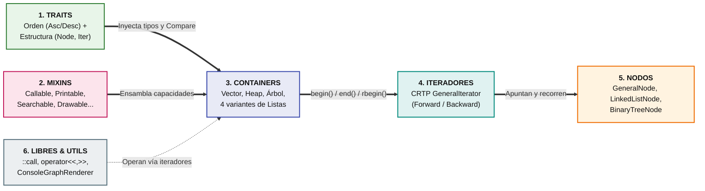
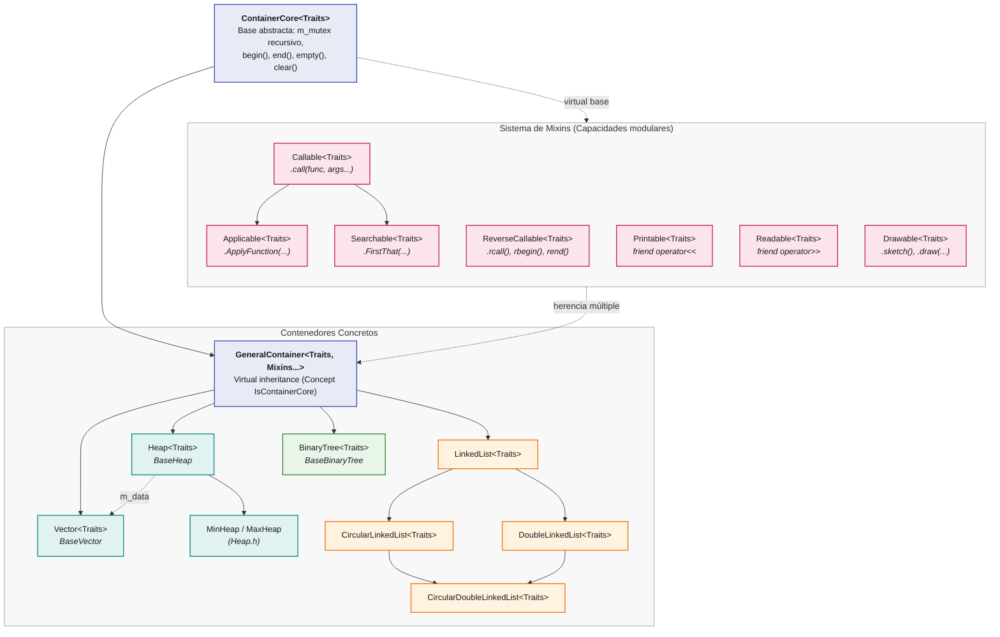
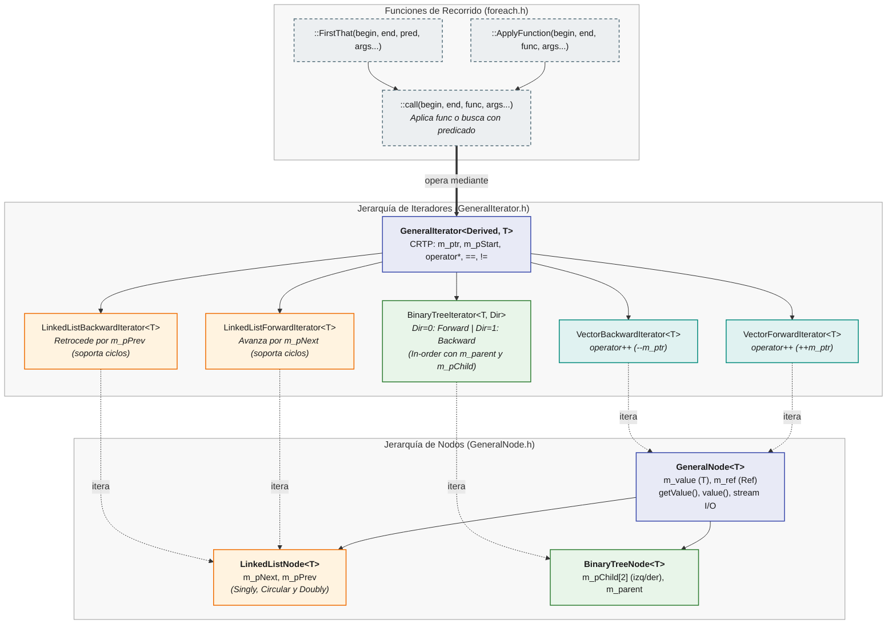

```mermaid
flowchart TB
    subgraph ORDEN["Políticas de Comparación (GeneralContainer.h)"]
        direction TB
        DT["<b>DefaultTraits#lt;T, Compare#gt;</b><br/>value_type = T, Compare = _Compare"]
        ASC["<b>AscendingTraits#lt;T#gt;</b><br/>Compare = std::less#lt;T#gt;"]
        DESC["<b>DescendingTraits#lt;T#gt;</b><br/>Compare = std::greater#lt;T#gt;"]
        DT --> ASC
        DT --> DESC
    end

    subgraph STRUCT["Políticas de Estructura (Node + Iteradores)"]
        direction TB
        VT["<b>VectorTraits#lt;T#gt;</b><br/>Node: GeneralNode<br/>Iter: VectorForward/Backward"]
        HT["<b>HeapTraits#lt;T#gt;</b><br/>Node: GeneralNode<br/>Iter: VectorForward"]
        LLT["<b>LinkedListTraits#lt;T#gt;</b><br/>Node: LinkedListNode<br/>Iter: LinkedListForward"]
        DLLT["<b>DoubleLinkedListTraits#lt;T#gt;</b><br/>Agrega: LinkedListBackward"]
        BTT["<b>BinaryTreeTraits#lt;T#gt;</b><br/>Node: BinaryTreeNode<br/>Iter: BinaryTreeForward/Backward"]

        LLT --> DLLT
    end

    subgraph COMBINED["Traits Compuestos (Orden + Estructura)"]
        direction TB
        V_TR["VectorAscTraits / VectorDescTraits"]
        H_TR["HeapAscTraits / HeapDescTraits"]
        LL_TR["LinkedListAscTraits / LinkedListDescTraits"]
        DLL_TR["DoubleLinkedListAscTraits / DoubleLinkedListDescTraits"]
        BT_TR["BinaryTreeAscTraits / BinaryTreeDescTraits"]
    end

    subgraph USERS["Contenedores Parametrizados"]
        direction TB
        U_V["Vector#lt;VectorAscTraits#lt;T#gt;#gt;"]
        U_H["Heap#lt;HeapAscTraits#lt;T#gt;#gt;"]
        U_LL["LinkedList#lt;LinkedListAscTraits#lt;T#gt;#gt;"]
        U_DLL["DoubleLinkedList#lt;DoubleLinkedListAscTraits#lt;T#gt;#gt;"]
        U_BT["BinaryTree#lt;BinaryTreeAscTraits#lt;T#gt;#gt;"]
    end

    ASC --> COMBINED
    DESC --> COMBINED
    VT --> V_TR
    HT --> H_TR
    LLT --> LL_TR
    DLLT --> DLL_TR
    BTT --> BT_TR

    V_TR ==> U_V
    H_TR ==> U_H
    LL_TR ==> U_LL
    DLL_TR ==> U_DLL
    BT_TR ==> U_BT

    classDef orden fill:#F3E5F5,stroke:#8E24AA,color:#1A1A1A,stroke-width:1.5px,font-size:15px;
    classDef struct fill:#E8EAF6,stroke:#3949AB,color:#1A1A1A,stroke-width:1.5px,font-size:15px;
    classDef comb fill:#FFF9C4,stroke:#FBC02D,color:#1A1A1A,stroke-width:1.5px,font-size:15px;
    classDef user fill:#E0F2F1,stroke:#00897B,color:#1A1A1A,stroke-width:1.5px,font-size:15px;

    class DT,ASC,DESC orden
    class VT,HT,LLT,DLLT,BTT struct
    class V_TR,H_TR,LL_TR,DLL_TR,BT_TR comb
    class U_V,U_H,U_LL,U_DLL,U_BT user

    style ORDEN fill:#8080800F,stroke:#9E9E9E,stroke-width:1px
    style STRUCT fill:#8080800F,stroke:#9E9E9E,stroke-width:1px
    style COMBINED fill:#8080800F,stroke:#9E9E9E,stroke-width:1px
    style USERS fill:#8080800F,stroke:#9E9E9E,stroke-width:1px
```

# 2026-II-CS-UNI-CC0E5-AEDAv

## 🏛️ Arquitectura del Repositorio

### 1. Vista General del Sistema

<b>2. Jerarquía de Contenedores y Sistema de Mixins</b>

<b>3. Sistema de Iteradores, Nodos y Recorridos</b>

<b>4. Sistema de Traits y Políticas de Orden</b>

