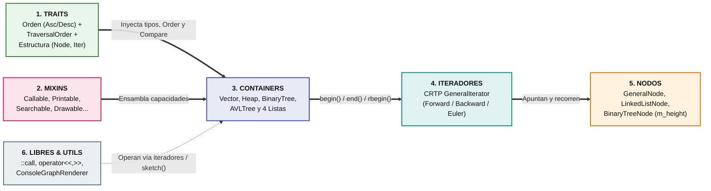
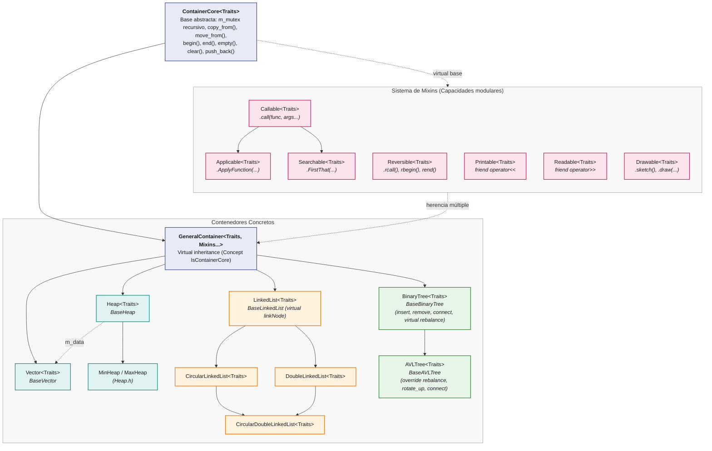
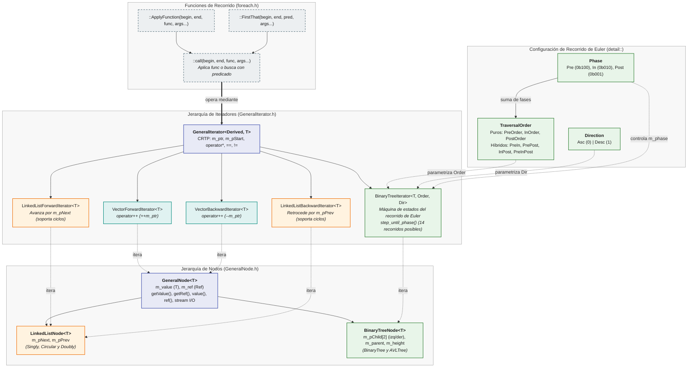
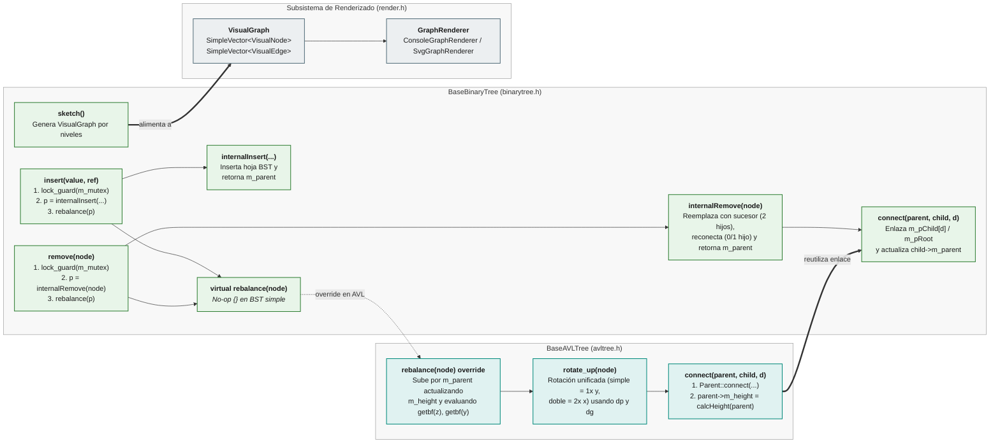

```mermaid
flowchart TB
    subgraph ORDEN["Políticas de Comparación (GeneralContainer.h)"]
        direction TB
        DT["<b>DefaultTraits#lt;T, Compare#gt;</b><br/>value_type = T, Compare = _Compare"]
        ASC["<b>AscendingTraits#lt;T#gt;</b><br/>Compare = std::less#lt;T#gt;"]
        DESC["<b>DescendingTraits#lt;T#gt;</b><br/>Compare = std::greater#lt;T#gt;"]
        DT --> ASC
        DT --> DESC
    end

    subgraph STRUCT["Políticas de Estructura (Node + Iteradores)"]
        direction TB
        VT["<b>VectorTraits#lt;T#gt;</b><br/>Node: GeneralNode<br/>Iter: VectorForward/Backward"]
        HT["<b>HeapTraits#lt;T#gt;</b><br/>Node: GeneralNode<br/>Iter: VectorForward"]
        LLT["<b>LinkedListTraits#lt;T#gt;</b><br/>Node: LinkedListNode<br/>Iter: LinkedListForward"]
        DLLT["<b>DoubleLinkedListTraits#lt;T#gt;</b><br/>Agrega: LinkedListBackward"]
        BTT["<b>BinaryTreeTraits#lt;T, Order#gt;</b><br/>Node: BinaryTreeNode<br/>Iter: BinaryTreeIterator (Asc/Desc)"]

        LLT --> DLLT
    end

    subgraph COMBINED["Traits Compuestos (Orden + Estructura)"]
        direction TB
        V_TR["VectorAscTraits / VectorDescTraits"]
        H_TR["HeapAscTraits / HeapDescTraits"]
        LL_TR["LinkedListAscTraits / LinkedListDescTraits"]
        DLL_TR["DoubleLinkedListAscTraits / DoubleLinkedListDescTraits"]
        BT_TR["BinaryTreeAscTraits#lt;T, Order = InOrder#gt;<br/>BinaryTreeDescTraits#lt;T, Order = InOrder#gt;"]
    end

    subgraph USERS["Contenedores Parametrizados"]
        direction TB
        U_V["Vector#lt;VectorAscTraits#lt;T#gt;#gt;"]
        U_H["Heap#lt;HeapAscTraits#lt;T#gt;#gt;"]
        U_LL["LinkedList / CircularLinkedList"]
        U_DLL["DoubleLinkedList / CircularDoubleLinkedList"]
        U_BT["BinaryTree#lt;BinaryTreeAscTraits#lt;T, Order#gt;#gt;"]
        U_AVL["AVLTree#lt;BinaryTreeAscTraits#lt;T, Order#gt;#gt;"]
    end

    ASC --> COMBINED
    DESC --> COMBINED
    VT --> V_TR
    HT --> H_TR
    LLT --> LL_TR
    DLLT --> DLL_TR
    BTT --> BT_TR

    V_TR ==> U_V
    H_TR ==> U_H
    LL_TR ==> U_LL
    DLL_TR ==> U_DLL
    BT_TR ==> U_BT
    BT_TR ==> U_AVL

    classDef orden fill:#F3E5F5,stroke:#8E24AA,color:#1A1A1A,stroke-width:1.5px,font-size:15px;
    classDef struct fill:#E8EAF6,stroke:#3949AB,color:#1A1A1A,stroke-width:1.5px,font-size:15px;
    classDef comb fill:#FFF9C4,stroke:#FBC02D,color:#1A1A1A,stroke-width:1.5px,font-size:15px;
    classDef user fill:#E0F2F1,stroke:#00897B,color:#1A1A1A,stroke-width:1.5px,font-size:15px;

    class DT,ASC,DESC orden
    class VT,HT,LLT,DLLT,BTT struct
    class V_TR,H_TR,LL_TR,DLL_TR,BT_TR comb
    class U_V,U_H,U_LL,U_DLL,U_BT,U_AVL user

    style ORDEN fill:#8080800F,stroke:#9E9E9E,stroke-width:1px
    style STRUCT fill:#8080800F,stroke:#9E9E9E,stroke-width:1px
    style COMBINED fill:#8080800F,stroke:#9E9E9E,stroke-width:1px
    style USERS fill:#8080800F,stroke:#9E9E9E,stroke-width:1px
```

# 2026-II-CS-UNI-CC0E5-AEDAv

## 🏛️ I. Arquitectura del Repositorio y Vistas de Subsistemas

### 1. Vista General del Sistema

<b>2. Jerarquía de Contenedores y Sistema de Mixins</b>

<b>3. Sistema de Iteradores, Nodos y Recorridos</b>

<b>4. Sistema de Traits y Políticas de Orden</b>

<b>5. Patrón Template Method en Árboles (BinaryTree / AVLTree) y Renderizado</b>

---

## ⚙️ II. Detalle de Aspectos Específicos

<b>1. Máquina de Estados del Recorrido de Euler por Fases</b>

#### A. ¿Cómo avanza el Recorrido de Euler por el contorno de un árbol?

El iterador [`BinaryTreeIterator<T, Order, Dir>`](containers/binarytree.h) modela el recorrido como una caminata continua por el **contorno exterior** del árbol. Al rodear el perímetro de cualquier subárbol, el iterador toca cada nodo exactamente en **3 momentos (fases)**:
- **🟢 Fase `0` (`FirstPhase` = `Phase::Pre` = `0b100`):** al bajar por el costado izquierdo del nodo (antes de visitar su subárbol izquierdo `I`).
- **🟡 Fase `1` (`Phase::In` = `0b010`):** al pasar por debajo del nodo (después de volver de `I` y antes de bajar a su subárbol derecho `D`).
- **🔴 Fase `2` (`LastPhase` = `Phase::Post` = `0b001`):** al subir por el costado derecho del nodo (después de volver de `D`, listo para regresar a su padre `P`).

La caminata completa genera la traza maestra del recorrido de Euler (`PreInPostOrder`), y tanto los recorridos **puros** (como `InOrder`) como los **híbridos** (como `PrePostOrder`) son **subsecuencias** filtradas de esta secuencia completa:

---

#### B. Máquina de Estados del Nodo Actual (`step_until_phase`)

En cada paso del bucle `do-while` de `step_until_phase()`, el nodo actual (`m_ptr`) evalúa su fase `(0)`, `(1)` o `(2)` y decide si **salta a un nodo vecino** (`I`, `D`, `P ➔ I`, `P ➔ D`, o `fin`) o si **avanza de fase dentro del mismo nodo**:

---

#### C. Puente entre Fases y Órdenes: Codificación en Máscara Binaria

Numerar las fases como `0`, `1` y `2` es un recurso didáctico para distinguir los tres contactos al rodear un nodo, pero en el código ([`containers/binarytree.h`](containers/binarytree.h)) cada fase es una potencia de 2 que ocupa **una posición de bit exclusiva** dentro de un número binario de 3 cifras (`Phase::Pre = 0b100`, `Phase::In = 0b010`, `Phase::Post = 0b001`). Así, cualquier `TraversalOrder` funciona como un panel de 3 interruptores donde cada cifra binaria **enciende (`1`)** o **apaga (`0`)** la parada del iterador en esa fase mediante `while (m_ptr && !(m_phase & Order))`:

---

#### D. Composición por Máscara de Bits: Diagrama de Venn de los 14 Recorridos

Al combinar los 3 bits de `{Phase::Pre, Phase::In, Phase::Post}`, las $2^3 - 1 = 7$ regiones no vacías de intersección definen los 3 órdenes **Puros** y los 4 órdenes **Híbridos** (con el recorrido de Euler completo `0b111` en la intersección triple central), que multiplicados por las 2 direcciones (`Asc` y `Desc`) producen los **14 recorridos**:

