<!-- omit in toc -->
# 2026-II-CS-UNI-CC0E5-AEDAv

- [🏛️ I. Arquitectura del Repositorio y Vistas de Subsistemas](#️-i-arquitectura-del-repositorio-y-vistas-de-subsistemas)
  - [1. Vista General del Sistema](#1-vista-general-del-sistema)
  - [2. Jerarquía de Contenedores, Vistas y Sistema de Mixins](#2-jerarquía-de-contenedores-vistas-y-sistema-de-mixins)
  - [3. Sistema de Iteradores, Nodos y Recorridos](#3-sistema-de-iteradores-nodos-y-recorridos)
  - [4. Sistema de Traits, Políticas de Orden y Desacoplamiento de Vistas](#4-sistema-de-traits-políticas-de-orden-y-desacoplamiento-de-vistas)
  - [5. Patrón Template Method en Árboles (BinaryTree / AVLTree), Invariante Rebuild y Renderizado](#5-patrón-template-method-en-árboles-binarytree--avltree-invariante-rebuild-y-renderizado)
  - [6. Arquitectura del Motor Modular de Layouts 2D y Roles Semánticos](#6-arquitectura-del-motor-modular-de-layouts-2d-y-roles-semánticos)
- [⚙️ II. Detalle de Aspectos Específicos](#️-ii-detalle-de-aspectos-específicos)
  - [1. Máquina de Estados del Recorrido de Euler por Fases](#1-máquina-de-estados-del-recorrido-de-euler-por-fases)
  - [2. Desacoplamiento Estructural: Separación de Contenedor y Recorrido mediante Vistas (BaseView)](#2-desacoplamiento-estructural-separación-de-contenedor-y-recorrido-mediante-vistas-baseview)
  - [3. Mecanismo de Rebalanceo AVL por Rotación Unificada (rotate\_up)](#3-mecanismo-de-rebalanceo-avl-por-rotación-unificada-rotate_up)
  - [4. Invariante de Reconstrucción de Contenedores (rebuild)](#4-invariante-de-reconstrucción-de-contenedores-rebuild)
  - [5. Subsistema de Renderizado ASCII en Consola (sketch y ConsoleGraphRenderer)](#5-subsistema-de-renderizado-ascii-en-consola-sketch-y-consolegraphrenderer)
  - [6. Contenedor Asociativo HashTable y Protocolo de Serialización en Capas](#6-contenedor-asociativo-hashtable-y-protocolo-de-serialización-en-capas)
  - [7. Contenedor Criptográfico MerkleTree y Pruebas de Auditoría](#7-contenedor-criptográfico-merkletree-y-pruebas-de-auditoría)
  - [8. Subsistema Modular de Layouts 2D y Roles Semánticos](#8-subsistema-modular-de-layouts-2d-y-roles-semánticos)
- [🚀 III. Guía de Uso y Demostración Práctica de la API](#-iii-guía-de-uso-y-demostración-práctica-de-la-api)
  - [1. Árboles Binarios y Recorridos Dinámicos en O(1)](#1-árboles-binarios-y-recorridos-dinámicos-en-o1)
  - [2. Contenedores Reversibles (Vistas Invertidas)](#2-contenedores-reversibles-vistas-invertidas)
  - [3. Renderizado Gráfico en Consola](#3-renderizado-gráfico-en-consola)
  - [4. Diccionario Asociativo (HashTable) y Persistencia](#4-diccionario-asociativo-hashtable-y-persistencia)
  - [5. Árbol de Merkle: Construcción, Mutación y Verificación de Pruebas](#5-árbol-de-merkle-construcción-mutación-y-verificación-de-pruebas)
  - [6. Personalización Visual de Contenedores con Layouts y Estilos ANSI](#6-personalización-visual-de-contenedores-con-layouts-y-estilos-ansi)


---

## 🏛️ I. Arquitectura del Repositorio y Vistas de Subsistemas

### 1. Vista General del Sistema

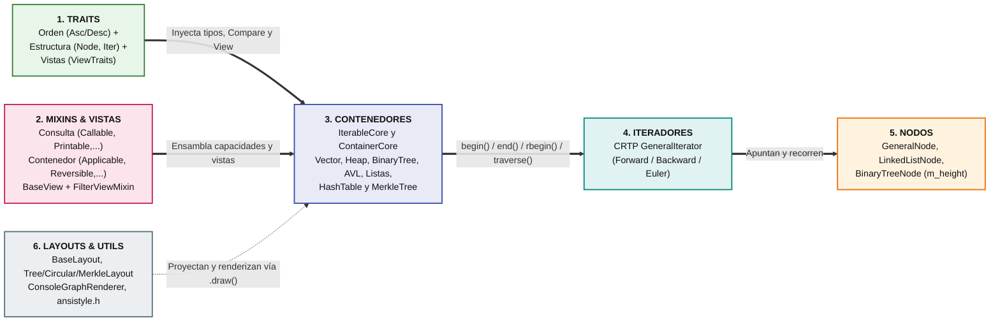

### 2. Jerarquía de Contenedores, Vistas y Sistema de Mixins

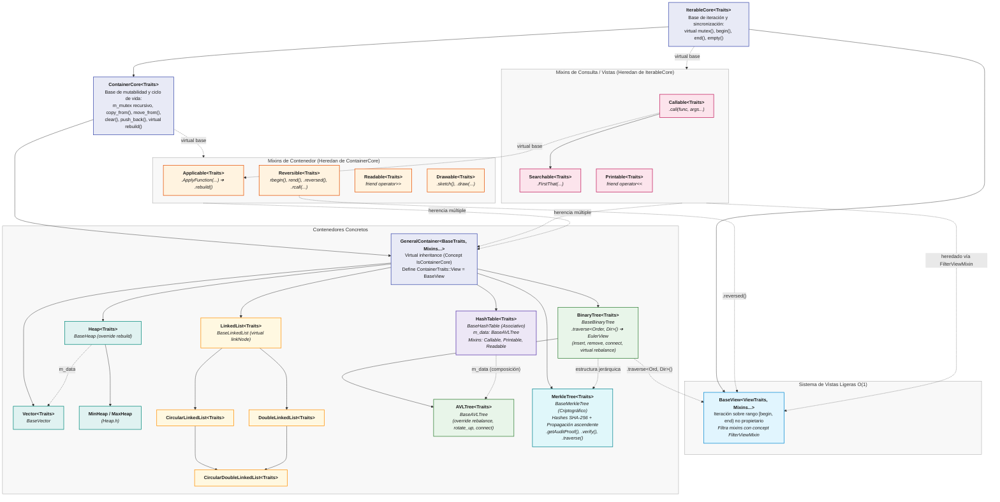

### 3. Sistema de Iteradores, Nodos y Recorridos

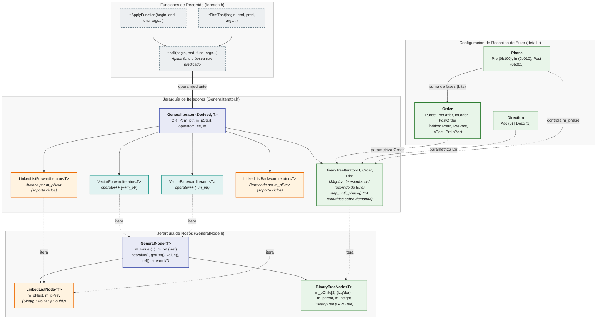

### 4. Sistema de Traits, Políticas de Orden y Desacoplamiento de Vistas

```mermaid
flowchart TB
    subgraph ORDEN["Políticas de Comparación (GeneralContainer.h)"]
        direction TB
        DT["<b>DefaultTraits#lt;T, Compare#gt;</b><br/>value_type = T, Compare = _Compare"]
        ASC["<b>AscendingTraits#lt;T#gt;</b><br/>Compare = std::less#lt;T#gt;"]
        DESC["<b>DescendingTraits#lt;T#gt;</b><br/>Compare = std::greater#lt;T#gt;"]
        DT --> ASC
        DT --> DESC
    end

    subgraph STRUCT["Políticas de Estructura (Node + Iteradores)"]
        direction TB
        VT["<b>VectorTraits#lt;T#gt;</b><br/>Node: GeneralNode<br/>Iter: VectorForward/Backward"]
        HT["<b>HeapTraits#lt;T#gt;</b><br/>Node: GeneralNode<br/>Iter: VectorForward"]
        LLT["<b>LinkedListTraits#lt;T#gt;</b><br/>Node: LinkedListNode<br/>Iter: LinkedListForward"]
        DLLT["<b>DoubleLinkedListTraits#lt;T#gt;</b><br/>Agrega: LinkedListBackward"]
        BTT["<b>BinaryTreeTraits#lt;T#gt;</b><br/>Node: BinaryTreeNode<br/>ForwardIter: InOrder Asc<br/>BackwardIter: InOrder Desc"]
        VWT["<b>ViewTraits#lt;NodeT, Iter#gt;</b><br/>value_type = NodeT::value_type<br/>Node = NodeT, Forward/Backward = Iter"]

        LLT --> DLLT
    end

    subgraph COMBINED["Traits Compuestos (Orden + Estructura)"]
        direction TB
        V_TR["VectorAscTraits / VectorDescTraits"]
        H_TR["HeapAscTraits / HeapDescTraits"]
        LL_TR["LinkedListAscTraits / LinkedListDescTraits"]
        DLL_TR["DoubleLinkedListAscTraits / DoubleLinkedListDescTraits"]
        BT_TR["BinaryTreeAscTraits#lt;T#gt;<br/>BinaryTreeDescTraits#lt;T#gt;"]
        HT_TR["<b>HashTableTraits#lt;Key, Value#gt;</b><br/>value_type = HashEntry#lt;Key, Value#gt;"]
        CTR["<b>ContainerTraits#lt;BaseTraits, Mixins...#gt;</b><br/>template View = BaseView#lt;ViewTraits, Mixins...#gt;"]
    end

    subgraph USERS["Contenedores y Vistas Parametrizadas"]
        direction TB
        U_V["Vector#lt;VectorAscTraits#lt;T#gt;#gt;"]
        U_H["Heap#lt;HeapAscTraits#lt;T#gt;#gt;"]
        U_LL["LinkedList / CircularLinkedList"]
        U_DLL["DoubleLinkedList / CircularDoubleLinkedList"]
        U_BT["BinaryTree#lt;BinaryTreeAscTraits#lt;T#gt;#gt;"]
        U_AVL["AVLTree#lt;BinaryTreeAscTraits#lt;T#gt;#gt;"]
        U_HT["HashTable#lt;HashTableTraits#lt;Key, Value#gt;#gt;"]
        U_VIEW["EulerView / ReverseView<br/><i>BaseView en O(1)</i>"]
    end

    ASC --> COMBINED
    DESC --> COMBINED
    VT --> V_TR
    HT --> H_TR
    LLT --> LL_TR
    DLLT --> DLL_TR
    BTT --> BT_TR
    BTT --> HT_TR

    V_TR ==> U_V
    H_TR ==> U_H
    LL_TR ==> U_LL
    DLL_TR ==> U_DLL
    BT_TR ==> U_BT
    BT_TR ==> U_AVL
    HT_TR ==> U_HT
    CTR -. "genera" .-> U_VIEW
    VWT -. "alimenta" .-> CTR

    classDef orden fill:#F3E5F5,stroke:#8E24AA,color:#1A1A1A,stroke-width:1.5px,font-size:15px;
    classDef struct fill:#E8EAF6,stroke:#3949AB,color:#1A1A1A,stroke-width:1.5px,font-size:15px;
    classDef comb fill:#FFF9C4,stroke:#FBC02D,color:#1A1A1A,stroke-width:1.5px,font-size:15px;
    classDef user fill:#E0F2F1,stroke:#00897B,color:#1A1A1A,stroke-width:1.5px,font-size:15px;

    class DT,ASC,DESC orden
    class VT,HT,LLT,DLLT,BTT,VWT struct
    class V_TR,H_TR,LL_TR,DLL_TR,BT_TR,HT_TR,CTR comb
    class U_V,U_H,U_LL,U_DLL,U_BT,U_AVL,U_HT,U_VIEW user

    style ORDEN fill:#8080800F,stroke:#9E9E9E,stroke-width:1px
    style STRUCT fill:#8080800F,stroke:#9E9E9E,stroke-width:1px
    style COMBINED fill:#8080800F,stroke:#9E9E9E,stroke-width:1px
    style USERS fill:#8080800F,stroke:#9E9E9E,stroke-width:1px
```

### 5. Patrón Template Method en Árboles (BinaryTree / AVLTree), Invariante Rebuild y Renderizado

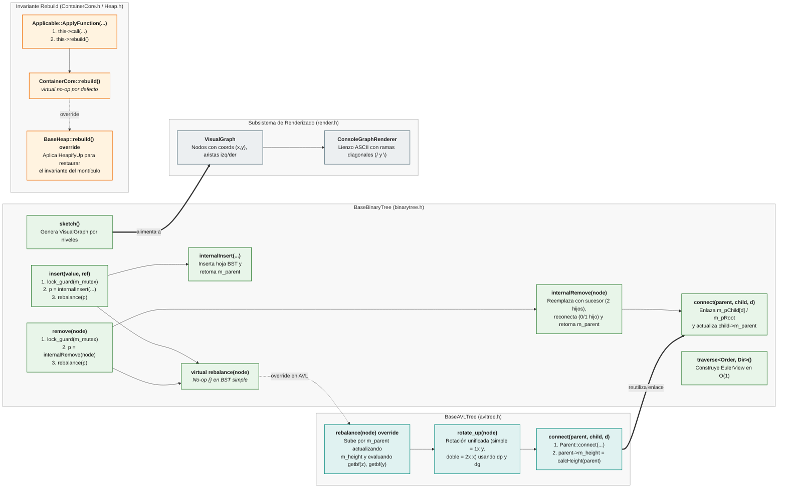

### 6. Arquitectura del Motor Modular de Layouts 2D y Roles Semánticos

El subsistema de proyección geométrica en [`utilities/layouts/`](utilities/layouts/) desacopla de manera estricta la topología espacial de cualquier contenedor respecto a su estilizado y coloración en terminal:

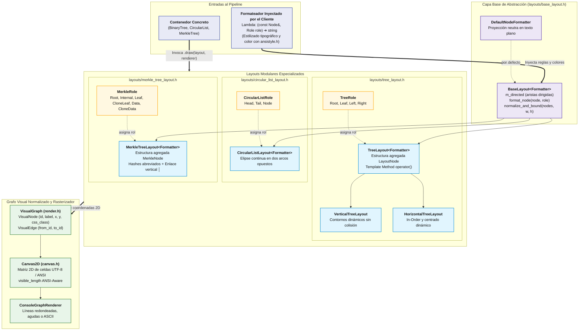

---

## ⚙️ II. Detalle de Aspectos Específicos

### 1. Máquina de Estados del Recorrido de Euler por Fases

#### A. ¿Cómo avanza el Recorrido de Euler por el contorno de un árbol?

El iterador [`BinaryTreeIterator<T, Order, Dir>`](containers/binarytree.h) modela el recorrido como una caminata continua por el **contorno exterior** del árbol. Al rodear el perímetro de cualquier subárbol, el iterador toca cada nodo exactamente en **3 momentos (fases)**:
- **🟢 Fase `0` (`FirstPhase` = `Phase::Pre` = `0b100`):** al bajar por el costado izquierdo del nodo (antes de visitar su subárbol izquierdo `I`).
- **🟡 Fase `1` (`Phase::In` = `0b010`):** al pasar por debajo del nodo (después de volver de `I` y antes de bajar a su subárbol derecho `D`).
- **🔴 Fase `2` (`LastPhase` = `Phase::Post` = `0b001`):** al subir por el costado derecho del nodo (después de volver de `D`, listo para regresar a su padre `P`).

La caminata completa genera la traza maestra del recorrido de Euler (`PreInPostOrder`), y tanto los recorridos **puros** (como `InOrder`) como los **híbridos** (como `PrePostOrder`) son **subsecuencias** filtradas de esta secuencia completa:


---

#### B. Máquina de Estados del Nodo Actual (`step_until_phase`)

En cada paso del bucle `do-while` de `step_until_phase()`, el nodo actual (`m_ptr`) evalúa su fase `(0)`, `(1)` o `(2)` y decide si **salta a un nodo vecino** (`I`, `D`, `P ➔ I`, `P ➔ D`, o `fin`) o si **avanza de fase dentro del mismo nodo**:

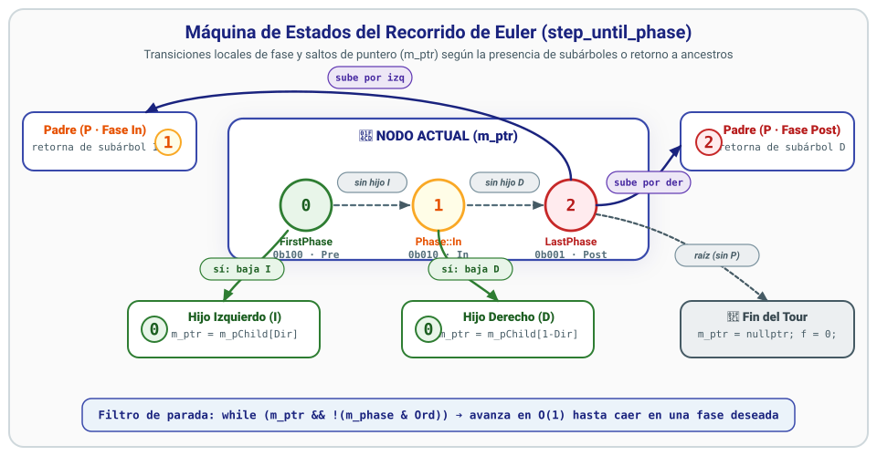

<details>
<summary>🔍 Ver especificación algorítmica y diagrama de flujo interno</summary>

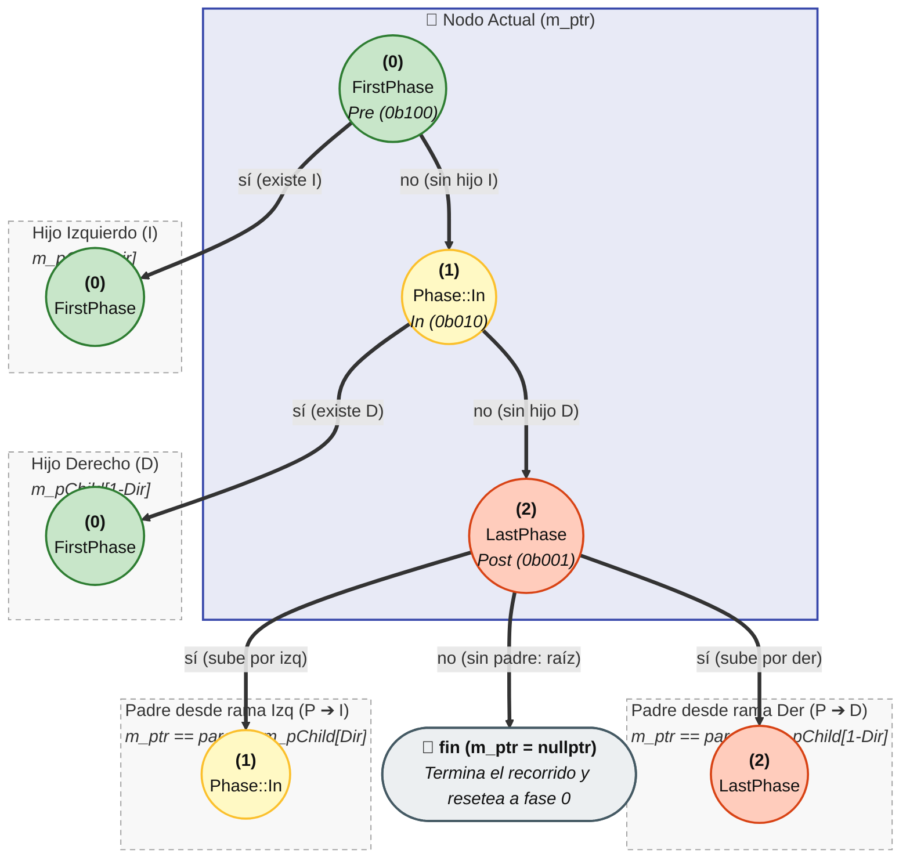

</details>

---

#### C. Puente entre Fases y Órdenes: Codificación en Máscara Binaria

Numerar las fases como `0`, `1` y `2` es un recurso didáctico para distinguir los tres contactos al rodear un nodo, pero en el código ([`containers/binarytree.h`](containers/binarytree.h)) cada fase es una potencia de 2 que ocupa **una posición de bit exclusiva** dentro de un número binario de 3 cifras (`Phase::Pre = 0b100`, `Phase::In = 0b010`, `Phase::Post = 0b001`). Así, cualquier orden de recorrido [`Order`](containers/binarytree.h) funciona como un panel de 3 interruptores donde cada cifra binaria **enciende (`1`)** o **apaga (`0`)** la parada del iterador en esa fase mediante `while (m_ptr && !(m_phase & Ord))`:


---

#### D. Composición por Máscara de Bits: Diagrama de Venn de los 14 Recorridos

Al combinar los 3 bits de `{Phase::Pre, Phase::In, Phase::Post}`, las $2^3 - 1 = 7$ regiones no vacías de intersección definen los 3 órdenes **Puros** y los 4 órdenes **Híbridos** (con el recorrido de Euler completo `0b111` en la intersección triple central), que multiplicados por las 2 direcciones (`Asc` y `Desc`) producen los **14 recorridos**:


### 2. Desacoplamiento Estructural: Separación de Contenedor y Recorrido mediante Vistas (BaseView)

#### A. Motivación y Principio de Responsabilidad Única

En diseños previos, el orden de recorrido formaba parte del parámetro de plantilla del árbol:
```cpp
// ❌ Diseño anterior acoplado:
template <typename T, TraversalOrder Order = InOrder>
struct BinaryTreeAscTraits;

BinaryTree<BinaryTreeAscTraits<int, TraversalOrder::PreOrder>> preTree;
BinaryTree<BinaryTreeAscTraits<int, TraversalOrder::PostOrder>> postTree;
```
Este diseño obligaba a **clonar el árbol o a instanciar contenedores separados** cada vez que se requería un recorrido distinto, violando el Principio de Responsabilidad Única (*SRP*):
1. **La estructura del árbol** (`BinaryTree` / `AVLTree`) es responsable de la propiedad jerárquica, las rotaciones, la inserción, el borrado y la sincronización concurrente (`m_mutex`).
2. **El recorrido** es simplemente una **proyección efímera (vista)** sobre el conjunto de nodos existentes, la cual no debe forzar la creación de un nuevo contenedor.

Con la refactorización arquitectural:
```cpp
// ✔️ Diseño desacoplado actual:
using DefaultTree = BinaryTree<BinaryTreeAscTraits<int>>;
DefaultTree tree;

// Acceso en O(1) tiempo y espacio a cualquiera de los 14 recorridos:
auto preView  = tree.traverse<Order::PreOrder>();
auto postView = tree.traverse<Order::PostOrder, Direction::Desc>();
```

---

#### B. Arquitectura de Jerarquía: `IterableCore` vs `ContainerCore`

Para permitir que tanto contenedores propietarios como vistas no propietarias compartan algoritmos y operadores, la jerarquía base se segregó en dos niveles ortogonales:

| Característica | `IterableCore<Traits>` | `ContainerCore<Traits>` |
| :--- | :--- | :--- |
| **Rol** | Rango iterable y sincronizable | Contenedor dinámico propietario de memoria |
| **Sincronización** | `virtual std::recursive_mutex& mutex() const = 0` | Posee `mutable std::recursive_mutex m_mutex` |
| **Métodos de Iteración** | `begin()`, `end()`, `empty()` | Heredados de `IterableCore` |
| **Mutabilidad / Ciclo de vida** | *Ninguno* (solo lectura de rango) | `clear()`, `push_back()`, `copy_from()`, `move_from()`, `rebuild()` |
| **Heredado por** | `BaseView`, `Callable`, `Searchable`, `Printable`, `ContainerCore` | `GeneralContainer`, `Applicable`, `Reversible`, `Readable`, `Drawable` |

---

#### C. Filtrado Estático de Mixins con Conceptos C++20 (`FilterViewMixin`)

Un contenedor concreto puede incorporar mixins mutantes como `Applicable` (que modifica nodos) o `Readable` (que llama a `clear()` y `push_back()`). Sin embargo, una **Vista (`BaseView`) no es dueña del contenedor ni debe modificar su topología**.

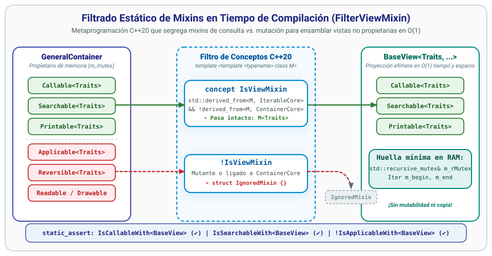

<details>
<summary>🔍 Ver implementación de conceptos C++20 y ensamblado de BaseView</summary>

Mediante metaprogramación de conceptos C++20 en [`containers/GeneralContainer.h`](containers/GeneralContainer.h), el sistema clasifica y filtra los mixins en tiempo de compilación:

```cpp
template <template <typename> typename M, typename Traits>
concept IsIterableMixin = std::derived_from<M<Traits>, IterableCore<Traits>>;

template <template <typename> typename M, typename Traits>
concept IsViewMixin =
    IsIterableMixin<M, Traits> &&
    !std::derived_from<M<Traits>, ContainerCore<Traits>>;

template <template <typename> typename M, typename Traits>
struct IgnoredMixin {};

template <template <typename> typename M, typename Traits>
using FilterViewMixin = std::conditional_t<
    IsViewMixin<M, Traits>,
    M<Traits>,
    IgnoredMixin<M, Traits>
>;
```

##### ¿Cómo se ensambla `BaseView`?
```cpp
template <typename Traits, template <typename> typename... Mixins>
    requires (IsIterableMixin<Mixins, Traits> && ...)
class BaseView :
    virtual public IterableCore<Traits>,
    virtual public FilterViewMixin<Mixins, Traits>... {
    // Almacena una referencia al mutex del contenedor y dos iteradores:
    std::recursive_mutex& m_rMutex;
    ForwardIterator       m_begin;
    ForwardIterator       m_end;
};
```

1. Si el contenedor tiene `Callable`, `Searchable` o `Printable` (que solo dependen de `IterableCore`), la vista los **hereda automáticamente**.
2. Si el contenedor tiene `Applicable`, `Readable` o `Reversible` (que dependen de `ContainerCore`), `FilterViewMixin` los transforma en `IgnoredMixin`, descartándolos a nivel de tipos sin overhead de memoria.
3. Se verifica formalmente con `static_assert` en [`Demos.cpp`](Demos.cpp):
   ```cpp
   static_assert(IsCallableWith<RevView, ...>);    // ✔️ Callable permitido en vista
   static_assert(IsSearchableWith<RevView, ...>);  // ✔️ Searchable permitido en vista
   static_assert(!IsApplicableWith<RevView, ...>); // ❌ Applicable descartado en vista
   ```

</details>

---

#### D. Vistas Bidireccionales con `Reversible::reversed()`

El mixin `Reversible` reemplaza y amplía la funcionalidad del antiguo `ReverseCallable`:
- Define `rbegin()` y `rend()`.
- Proporciona `.reversed()`, el cual construye una vista reversa `ReverseView` en $O(1)$:
  ```cpp
  auto reversed() const {
      std::lock_guard lock(this->mutex());
      using ReverseView = typename Traits::template View<Node, BackwardIterator>;
      return ReverseView(this->mutex(), rbegin(), rend());
  }
  ```
- Simplifica la implementación de `.rcall(...)`:
  ```cpp
  template<typename Func, typename... Args>
  decltype(auto) rcall(Func func, Args&&... args) const {
      return reversed().call(std::forward<Func>(func), std::forward<Args>(args)...);
  }
  ```
- Dado que `ReverseView` hereda `Printable` y `Searchable`, ahora es posible imprimir y buscar en orden inverso de forma directa:
  ```cpp
  std::cout << "Vista invertida: " << vec.reversed() << std::endl;
  Node& last = vec.reversed().FirstThat(IsGreaterThan<Node, int>, 5);
  ```

---

#### E. Vistas de Recorridos en Árboles con `tree.traverse<Order, Direction>()`

En [`containers/binarytree.h`](containers/binarytree.h), `BaseBinaryTree` ofrece el método plantilla `.traverse()`:
```cpp
template <Order Ord, Direction Dir = Direction::Asc>
auto traverse() const {
    std::lock_guard lock(this->mutex());
    using Iter = BinaryTreeIterator<value_type, Ord, Dir>;
    using EulerView = typename Parent::Traits::template View<Node, Iter>;
    return EulerView(this->mutex(), Iter(m_pRoot), Iter(nullptr));
}
```

Cualquiera de los 14 recorridos de Euler es accesible de inmediato como un objeto iterable de primera clase con soporte para:
- Impresión directa con `operator<<`: `std::cout << tree.traverse<Order::PreOrder>();`
- Búsqueda funcional: `tree.traverse<Order::PostOrder>().FirstThat(pred, key);`
- Invocación genérica: `tree.traverse<Order::PreInOrder>().call(func, args...);`
- Bucles basados en rango: `for (const auto& node : tree.traverse<Order::PreInPostOrder, Direction::Desc>())`

### 3. Mecanismo de Rebalanceo AVL por Rotación Unificada (rotate_up)

En [`containers/avltree.h`](containers/avltree.h), `BaseAVLTree` implementa el auto-balanceo extendiendo `BaseBinaryTree` mediante el patrón **Template Method**:
1. Las operaciones de mutación (`insert` y `remove`) delegan la restauración del árbol al hook virtual `rebalance(node)`.
2. Al insertar o eliminar, `BaseAVLTree::rebalance(node)` asciende por los ancestros actualizando `m_height = 1 + std::max(h_izq, h_der)`.
3. Cuando detecta un nodo desbalanceado $Z$ con factor de balance $|bf(Z)| > 1$ (donde $bf = h \text{izq} - h \text{der}$):
   - Identifica al hijo más alto $Y = Z\text{->m pChild}[bf Z < 0]$.
   - Identifica al nieto más alto $X = Y\text{->m pChild}[bf Y < 0]$.

#### A. Primitiva de Rotación Unificada `rotate_up(node)`

En lugar de codificar 4 variantes manuales de rotación (`LL`, `RR`, `LR`, `RL`), la arquitectura unifica cualquier rotación en una única primitiva simétrica parametrizada por la posición relativa del nodo:

```cpp
void rotate_up(NodePtr node) {
    NodePtr node_p = node->m_parent;
    NodePtr node_g = node_p->m_parent;
    TX dp = node_p && node == node_p->m_pChild[1];  // true (1) si node es hijo derecho
    TX dg = node_g && node_p == node_g->m_pChild[1]; // true (1) si parent es hijo derecho
    connect(node_p, node->m_pChild[1-dp], dp);      // Adopta el subárbol cruzado
    connect(node, node_p, 1-dp);                    // node_p pasa a ser hijo de node
    connect(node_g, node, dg);                      // node se enlaza al abuelo
}
```

Cada invocación a `connect(parent, child, d)` enlaza los punteros bidireccionales y recalcula inmediatamente `parent->m_height`.

#### B. Clasificación de Casos: Simple (1x) vs. Compuesta (2x)

- **Caso en Línea (LL / RR)** ($bf Z \cdot bf Y > 0$ o $bf Y = 0$):
  Tanto $Y$ como $X$ se encuentran alineados en la misma dirección. Se resuelve con **1 rotación** ascendiendo al hijo $Y$:
  ```cpp
  rotate_up(node->m_parent); // Asciende Y al lugar de Z
  ```
- **Caso en Zig-Zag (LR / RL)** ($bf Z \cdot bf Y < 0$):
  Existe un cambio de dirección en el camino $Z \to Y \to X$ ("codo"). Se resuelve con **2 rotaciones** sucesivas ascendiendo al nieto $X$:
  ```cpp
  rotate_up(node); // 1ra rotación: asciende X al lugar de Y (convierte LR en LL)
  rotate_up(node); // 2da rotación: asciende X al lugar de Z (balancea el subárbol)
  ```


El diagrama animado superior ilustra cómo la transformación geométrica preserva de forma estricta la invariante del recorrido in-order:

$T 1 < (X \text{ o } Y) < T 2 < (Y \text{ o } X) < T 3 < Z < T 4$

### 4. Invariante de Reconstrucción de Contenedores (rebuild)

Cuando se ejecutan operaciones masivas que transforman el valor de los nodos in-place (como `ApplyFunction`), las invariantes estructurales de ciertos contenedores pueden invalidarse.

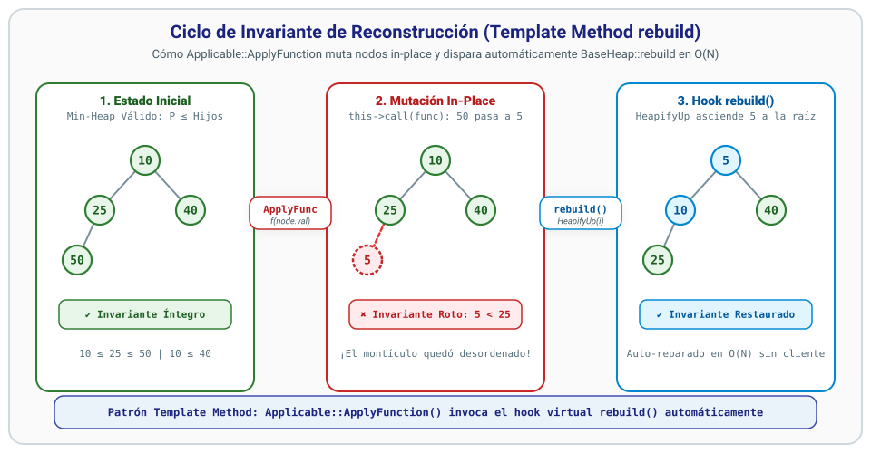

<details>
<summary>🔍 Ver implementación del patrón Template Method y hook virtual</summary>

Para solventar esto de manera limpia y polimórfica:
1. `ContainerCore` introduce el método virtual no-op:
   ```cpp
   virtual void rebuild() {}
   ```
2. El mixin `Applicable` ejecuta la función sobre cada nodo y de inmediato invoca a `rebuild()`:
   ```cpp
   template <typename Func, typename... Args>
   void ApplyFunction(Func func, Args&&... args) {
       std::lock_guard lock(this->mutex());
       this->call(std::forward<Func>(func), std::forward<Args>(args)...);
       this->rebuild(); // Hook de restauración del invariante
   }
   ```
3. En [`containers/Heap.h`](containers/Heap.h), `BaseHeap` sobreescribe `rebuild()`:
   ```cpp
   template <typename Traits, template <typename> typename... Mixins>
   void BaseHeap<Traits, Mixins...>::rebuild() {
       std::lock_guard lock(m_mutex);
       for (size_t i = 1; i < size(); ++i) HeapifyUp(i);
   }
   ```
   Garantizando que tras un `ApplyFunction(AddOne)` o `ApplyFunction(AddX, 10)`, el árbol binario completo que respalda el montículo restablezca su propiedad de orden en $O(N)$ sin requerir intervención manual del cliente.

</details>

### 5. Subsistema de Renderizado ASCII en Consola (sketch y ConsoleGraphRenderer)

El subsistema visual en [`utilities/render.h`](utilities/render.h) separa la representación lógica del grafo de su renderizado visual:

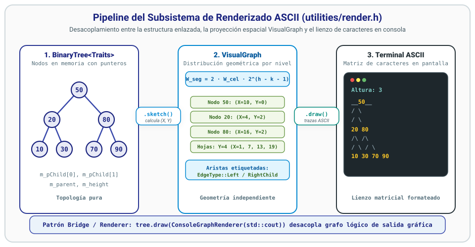

<details>
<summary>🔍 Ver detalles del cálculo espacial de niveles y salida en consola</summary>

1. **`VisualGraph sketch() const`**:
   `BaseBinaryTree::sketch()` calcula la geometría del árbol en anchura y altura:

   $\text{segment} \text{width} = 2 \cdot \text{cell} \text{width} \cdot 2^{h - k - 1}$

   Asigna coordenadas $X, Y$ a cada nodo por niveles y genera aristas etiquetadas como `LeftChild` o `RightChild`.

2. **`ConsoleGraphRenderer`**:
   Construye un lienzo matricial en memoria:
   - Dibuja barras horizontales de extensión `_`.
   - Traza ramas diagonales simétricas:
     - `/` hacia el hijo izquierdo (`LeftChild`).
     - `\` hacia el hijo derecho (`RightChild`).
   - Centra las etiquetas de los nodos sobre sus respectivas bifurcaciones.

Ejemplo de salida en terminal:
```text
(Altura: 3)
          __50__
         /      \
        /        \
      20          80
      /\          /\
     /  \        /  \
   10    30    70    90
```

</details>

### 6. Contenedor Asociativo HashTable y Protocolo de Serialización en Capas

[`HashTable`](containers/hashtable.h) provee una interfaz asociativa clave-valor construida sobre la arquitectura genérica del repositorio. Internamente, `BaseHashTable` compone una instancia de `BaseAVLTree` para garantizar búsquedas, inserciones y validaciones de pertenencia en $O(\log N)$ con sincronización concurrente (`m_mutex`).

#### A. Arquitectura de Serialización Multicapa (Unwrapping I/O)

La serialización (`Printable`) y deserialización (`Readable`) implementa un desacoplamiento estricto por niveles de abstracción: ninguna capa superior o inferior interfiere con los delimitadores de sus capas contiguas:

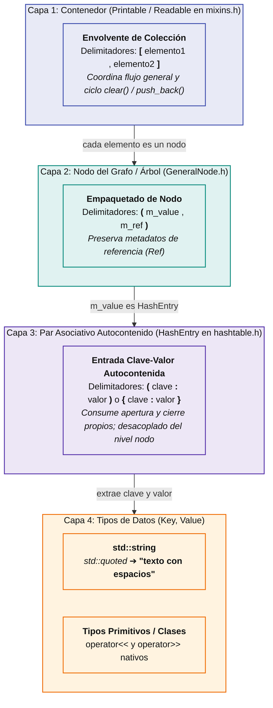

- **Invariante de autocontención**: Al poseer delimitadores de apertura y cierre propios (`(` y `)` o `{` y `}`), `HashEntry` nunca colisiona con la coma `,` que `GeneralNode` utiliza para separar `m_value` de `m_ref`.
- **Soporte de cadenas arbitrarias**: El uso de `std::quoted` (vía `<iomanip>`) asegura que cadenas con espacios, caracteres Unicode o signos de puntuación se deserialicen íntegras sin interrumpir el flujo.

---

#### B. Diagrama de Secuencia de Deserialización (`Readable` + `operator>>`)

El flujo secuencial de extracción muestra cómo cada nivel consume exactamente sus tokens sin invadir el cursor de la capa adyacente:

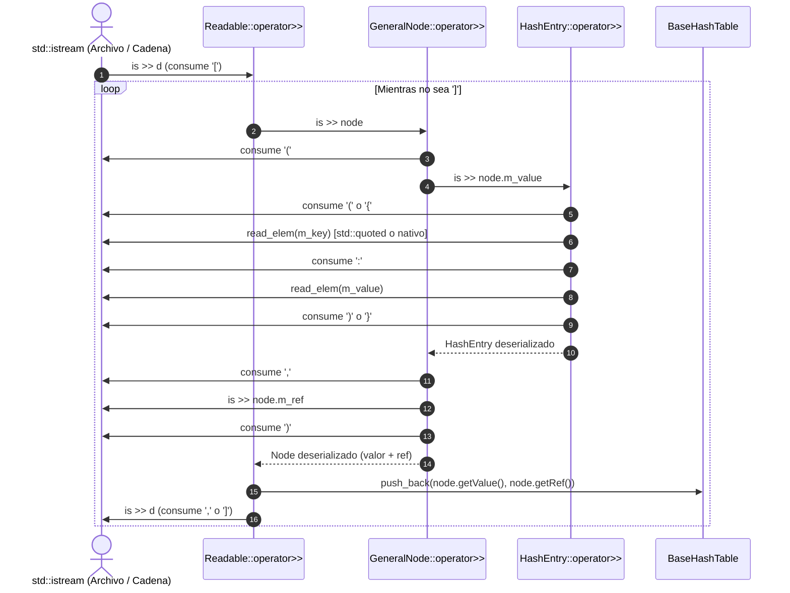

---

#### C. Flujo Operacional de `BaseHashTable`

Las operaciones de acceso, pertenencia y reconstrucción delegan en el árbol balanceado interno garantizando seguridad concurrente:

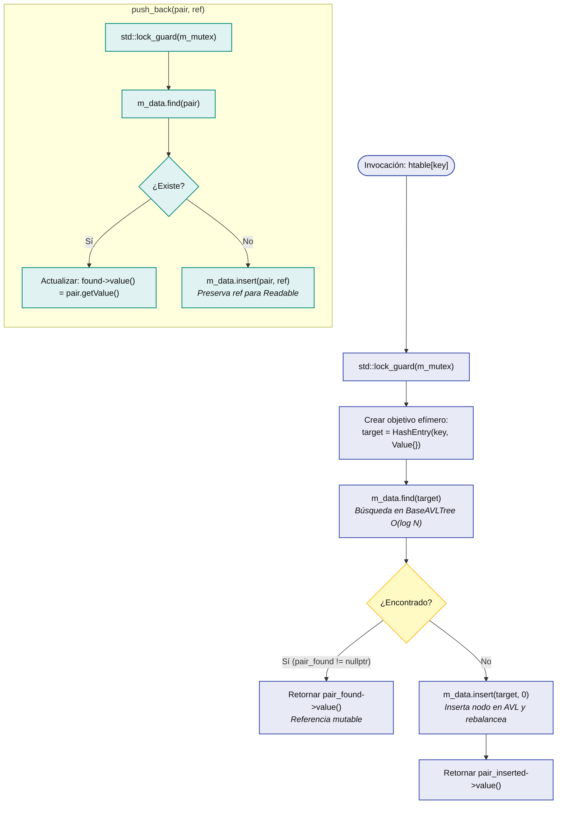

- **`operator[]`**: Inserta perezosamente bajo demanda si la clave no existe, retornando una referencia modificable en $O(\log N)$.
- **`contains(key)`**: Consulta de solo lectura que no altera la topología del árbol.
- **`push_back(pair, ref)`**: Hook requerido por `Readable` que preserva la referencia (`Ref`) original de cada nodo.

---

### 7. Contenedor Criptográfico MerkleTree y Pruebas de Auditoría

[`MerkleTree`](containers/merkletree.h) implementa un árbol de autenticación criptográfica basado en la arquitectura de nodos y contenedores del repositorio (`GeneralContainer` con `BinaryTreeNode`). Permite registrar colecciones inmutables de transacciones o bloques de datos, computar de forma jerárquica la raíz criptográfica (*Merkle Root*) mediante funciones hash criptográficas (como SHA-256), y generar pruebas de inclusión en $O(\log N)$ con preservación total de privacidad.

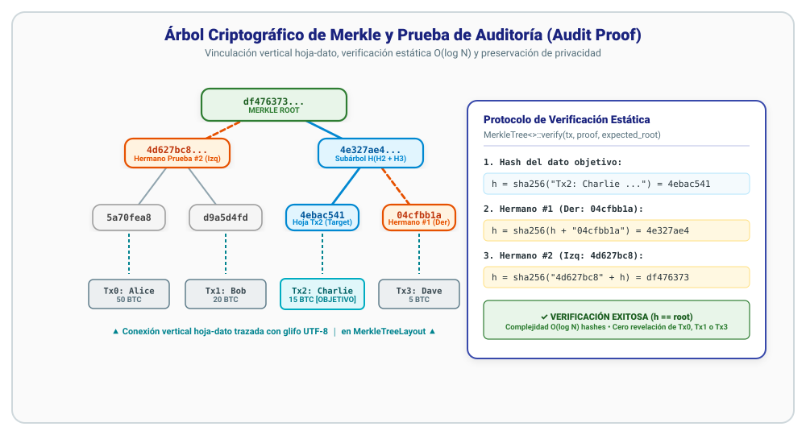

#### A. Estructura y Propagación Criptográfica de Hashes

En el árbol de Merkle:
1. **Nivel de Hojas de Datos ($D_i$)**: Contiene los datos originales de las transacciones (`std::string`).
2. **Nivel de Hojas Hash ($H_i$)**: Cada hoja almacena el hash criptográfico directo de su transacción:
   $$H_i = \text{Hash}(D_i)$$
3. **Nodos Internos**: Cada nodo padre combina los hashes de sus dos hijos en un único hash concatenado:
   $$H_{\text{padre}} = \text{Hash}(H_{\text{izq}} \parallel H_{\text{der}})$$
4. **Propagación Ascendente Inmediata**:
   Al invocar `updateData(idx, newData)`, el árbol actualiza el dato original, recalcula la hoja correspondiente y asciende de forma recursiva por la cadena de ancestros hasta la raíz en $O(\log N)$:
   $$\text{Raíz nueva} = \text{MerkleTree}::\text{getRootHash}()$$
   Cualquier alteración en un solo carácter de una transacción invalida la raíz previa, proporcionando detección instantánea de manipulación o corrupción de datos.

---

#### B. Manejo de Cantidad Impar de Hojas y Hojas Clonadas

En árboles binarios completos donde el número de transacciones $N$ es impar, el último dato se empareja duplicando su propio hash para garantizar que el árbol sea estrictamente balanceado:
$$\text{Si } N = 5 \implies \text{Hojas: } [H_0, H_1, H_2, H_3, H_4, H_4']$$
El motor de layouts y roles semánticos clasifica automáticamente a este nodo con el rol `MerkleRole::CloneLeaf` y a su dato vinculado con `MerkleRole::CloneData`, permitiendo que el cliente visualice la hoja clonada con estilo atenuado o cursivo (`.dim().italic()`) para distinguirla claramente de las transacciones genuinas.

---

#### C. Generación de Pruebas de Auditoría (*Merkle Audit Proof*)

Una **Prueba de Inclusión** (*Merkle Audit Proof*) permite a un cliente o auditor certificar que una transacción específica $D_k$ pertenece al conjunto autenticado por la raíz sin necesidad de descargar ni conocer ninguna de las demás transacciones:

```cpp
// Genera la prueba compacta para la transacción en la posición target_index:
auto proof = mtree.getAuditProof(target_index);
```

La prueba es un vector de pares `std::vector<std::pair<std::string, bool>>` de tamaño $\lceil \log_2 N \rceil$:
- `first`: Hash del nodo hermano en ese nivel de altura.
- `second`: Booleano `is_left` que indica si el hermano debe concatenarse a la izquierda (`true`) o a la derecha (`false`).

---

#### D. Protocolo y Algoritmo de Verificación Estática

La verificación se realiza de manera totalmente estática e independiente de cualquier instancia del árbol mediante `MerkleTree<>::verify(...)`:

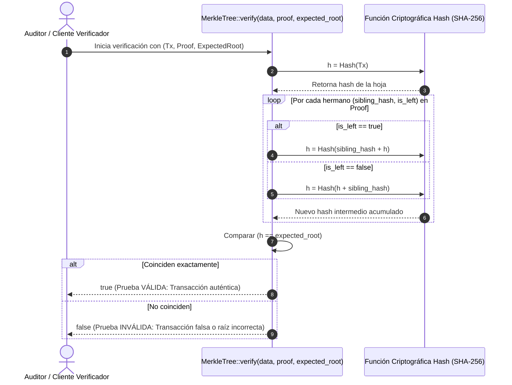

---

### 8. Subsistema Modular de Layouts 2D y Roles Semánticos

El directorio [`utilities/layouts/`](utilities/layouts/) implementa una arquitectura desacoplada que separa la formulación geométrica de los grafos en 2D de la presentación tipográfica y cromática:

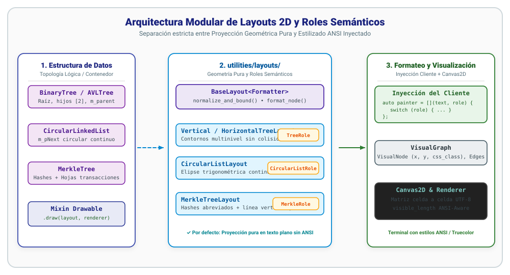

#### A. Principio de Separación: Geometría Pura vs. Coloración Inyectada

1. **La Capa de Layout es Neutra**:
   Las clases derivadas de `BaseLayout` (`VerticalTreeLayout`, `HorizontalTreeLayout`, `CircularListLayout`, `MerkleTreeLayout`) tienen una única responsabilidad: calcular las coordenadas espaciales $(X, Y)$, los contornos de subárboles para evitar solapamientos y las aristas dirigidas/no dirigidas. Por defecto utilizan `DefaultNodeFormatter`, proyectando texto plano sin secuencias de escape ANSI.
2. **Inyección de Estilos por el Cliente**:
   El cliente inyecta una función o lambda que recibe el nodo (o texto) y su **rol semántico** (`enum class Role`), devolviendo una cadena con el formato deseado mediante el motor tipográfico [`ansistyle.h`](utilities/ansistyle.h).

---

#### B. Catálogo de Roles Semánticos y Clases CSS

Cada layout define su propio `enum class` de roles semánticos mutuamente excluyentes, acompañados de una función `to_css_class(role)` que serializa el rol a su identificador CSS correspondiente en `VisualNode::css_class`:

| Layout | Enum de Rol | Valores del Enum | Clases CSS (`to_css_class`) | Propósito Topológico |
| :--- | :--- | :--- | :--- | :--- |
| [`TreeLayout`](utilities/layouts/tree_layout.h) | `TreeRole` | `Root`, `Leaf`, `Left`, `Right` | `"root"`, `"leaf"`, `"left"`, `"right"` | Distingue la raíz, las hojas terminales y las ramas internas izquierda/derecha. |
| [`CircularListLayout`](utilities/layouts/circular_list_layout.h) | `CircularListRole` | `Head`, `Tail`, `Node` | `"head"`, `"tail"`, `"node"` | Identifica el inicio de la lista circular, el último nodo antes del cierre, y nodos intermedios. |
| [`MerkleTreeLayout`](utilities/layouts/merkle_tree_layout.h) | `MerkleRole` | `Root`, `Internal`, `Leaf`, `CloneLeaf`, `Data`, `CloneData` | `"root"`, `"internal"`, `"leaf"`, `"clone-leaf"`, `"data"`, `"clone-data"` | Distingue la raíz criptográfica, hashes internos, hojas de hash originales o clonadas, y nodos de transacción base. |

El cliente utiliza la sentencia `switch (role)` nativa de C++23, lo que permite al compilador verificar de forma exhaustiva (`-Wswitch`) que todos los roles sean atendidos:

```cpp
auto painter = [](const std::string& text, MerkleRole role) {
    switch (role) {
        case MerkleRole::Root:      return styled(text.substr(0, 8)).bold().bright_green().str();
        case MerkleRole::Leaf:      return styled(text.substr(0, 8)).bold().bright_yellow().str();
        case MerkleRole::CloneLeaf: return styled(text.substr(0, 8)).dim().italic().str();
        case MerkleRole::Internal:  return styled(text.substr(0, 8)).dim().str();
        case MerkleRole::Data:      return styled("[" + text + "]").bright_cyan().str();
        case MerkleRole::CloneData: return styled("[" + text + " (copia)]").dim().italic().str();
    }
    return text;
};
```

---

#### C. Motor Tipográfico ANSI y Ancho Visual (`ansistyle.h`)

[`utilities/ansistyle.h`](utilities/ansistyle.h) implementa el repertorio completo de estilos y secuencias de escape ANSI para terminales modernas:
- **Builder Fluido `styled(...)`**: Encadenamiento legible de modificaciones (`styled("texto").bold().underline().bright_yellow()`).
- **Soporte TrueColor de 24 Bits**: Colores RGB directos (`rgb(r, g, b)`, `hex("#RRGGBB")`).
- **Prevención de Gris por `Bold` con `pure_black()`**:
  En terminales ANSI estándar, la combinación `black()` (`\033[30m`) + `bold()` (`\033[1m`) convierte el negro en `Bright Black` (`\033[90m`), produciendo texto gris (`#666666`). El método `pure_black()` emite TrueColor 24-bit `\033[38;2;0;0;0m`, garantizando color negro absoluto sobre fondos claros:
  ```cpp
  cout << styled(" █ Pruebas ").pure_black().bg_bright_yellow() << "\n\n";
  ```
- **Cálculo de Ancho Visual Libre de Secuencias (`visible_length`)**:
  La función `visible_length(std::string_view)` analiza la cadena caracter a caracter ignorando bytes pertenecientes a códigos de escape ANSI `\033[...m` y calculando el número real de columnas de terminal monoespaciadas que ocuparán los glifos UTF-8.

---

#### D. Lienzo Matricial `Canvas2D` y Trazado de Conexiones Verticales `│`

[`Canvas2D`](utilities/canvas.h) administra una matriz direccionable $(x, y)$ donde cada celda almacena un glifo UTF-8 junto a sus atributos ANSI:
- **Sin Desfases Geométricos**: Al escribir cadenas formateadas con ANSI en las coordenadas del nodo, las secuencias de escape se asocian a la primera celda visible sin avanzar columnas espaciales en la matriz.
- **Conexiones Verticales Puras (`│`)**: `MerkleTreeLayout` proyecta aristas verticales con alineación milimétrica entre cada hoja de hash y su dato original subyacente.

---

## 🚀 III. Guía de Uso y Demostración Práctica de la API

Demostración concisa de los casos de uso más frecuentes de los contenedores y vistas del repositorio.

### 1. Árboles Binarios y Recorridos Dinámicos en O(1)

```cpp
#include "containers/binarytree.h"
#include "containers/avltree.h"

// 1. Instanciación con Traits por defecto (InOrder estándar)
BinaryTree<BinaryTreeAscTraits<int>> tree;
tree.insert(50, 1);
tree.insert(20, 2);
tree.insert(80, 3);
tree.insert(10, 4);
tree.insert(30, 5);

// 2. Iteración estándar (InOrder Ascendente)
std::cout << "InOrder natural: " << tree << std::endl;

// 3. Proyección en O(1) de los 14 recorridos de Euler
std::cout << "PreOrder: "  << tree.traverse<Order::PreOrder>()  << std::endl;
std::cout << "PostOrder: " << tree.traverse<Order::PostOrder>() << std::endl;
std::cout << "Euler Desc: " 
          << tree.traverse<Order::PreInPostOrder, Direction::Desc>() 
          << std::endl;

// 4. Búsqueda y algoritmos sobre vistas
auto& found = tree.traverse<Order::PostOrder>().FirstThat(
    [](const auto& node, int x) { return node.getValue() > x; }, 
    25
);
std::cout << "Primer nodo en PostOrder > 25: " << found << std::endl;
```

### 2. Contenedores Reversibles (Vistas Invertidas)

```cpp
#include "containers/vector.h"

Vector<VectorAscTraits<int>> vec = {{1, 10}, {2, 20}, {3, 30}, {4, 40}};

// Imprimir directamente en sentido inverso sin alterar la estructura:
std::cout << "Invertido: " << vec.reversed() << std::endl;

// Búsqueda desde el final hacia el inicio:
auto& last_gt = vec.reversed().FirstThat(
    [](const auto& node, int x) { return node.getValue() > x; },
    20
);
```

### 3. Renderizado Gráfico en Consola

```cpp
#include "utilities/render.h"

// Dibujo directo en consola utilizando el mixin Drawable:
tree.draw(ConsoleGraphRenderer(std::cout));
```

### 4. Diccionario Asociativo (HashTable) y Persistencia

```cpp
#include "containers/hashtable.h"

// 1. Instanciación con clave string y valor int
HashTable<HashTableTraits<std::string, int>> htable;
htable["a"] = 42;
htable["b"] = 7;
htable["la hermenéutica telúrica incáica"] = 9;

// 2. Consulta de pertenencia y acceso mutable
if (htable.contains("b")) {
    std::cout << "Clave 'b' encontrada: " << htable["b"] << std::endl;
}

// 3. Serialización automática formateada (Printable)
// Salida: [(("la hermenéutica telúrica incáica":9),0),(("b":7),0),(("a":42),0)]
std::cout << "HashTable serializado: " << htable << std::endl;

// 4. Deserialización íntegra respetando espacios en blanco (Readable)
std::stringstream ss;
ss << htable;

HashTable<HashTableTraits<std::string, int>> htable_restored;
ss >> htable_restored;
std::cout << "Restaurado: " << htable_restored["la hermenéutica telúrica incáica"] << std::endl;
```

### 5. Árbol de Merkle: Construcción, Mutación y Verificación de Pruebas

```cpp
#include "containers/merkletree.h"
#include "utilities/render.h"
#include "utilities/layouts.h"

// 1. Instanciación e inserción de transacciones
MerkleTree<> mtree;
mtree.push_back("Tx0: Alice -> Bob 50 BTC", 0);
mtree.push_back("Tx1: Bob -> Charlie 20 BTC", 1);
mtree.push_back("Tx2: Charlie -> Dave 15 BTC", 2);
mtree.push_back("Tx3: Dave -> Eve 5 BTC", 3);

// 2. Consulta de Raíz Criptográfica
std::string root = mtree.getRootHash();
std::cout << "Merkle Root: " << root << std::endl;

// 3. Generación de Prueba de Auditoría para Tx2
std::string target_tx = mtree.getData(2);
auto proof = mtree.getAuditProof(2);

// 4. Verificación estática e independiente
bool is_valid = MerkleTree<>::verify(target_tx, proof, root);
std::cout << "¿Prueba válida? " << (is_valid ? "SÍ (Auténtica)" : "NO") << std::endl;

// 5. Detección inmediata de manipulación (Mutación)
mtree.updateData(2, "Tx2: Charlie -> Dave 999 BTC FRAUDE");
std::string new_root = mtree.getRootHash();
std::cout << "¿Raíz alterada tras fraude? " 
          << (root != new_root ? "SÍ (Detección instantánea)" : "NO") << std::endl;

// La prueba previa queda automáticamente invalidada:
bool old_proof_valid = MerkleTree<>::verify(target_tx, proof, new_root);
std::cout << "¿Prueba vieja válida en nueva raíz? " 
          << (old_proof_valid ? "VÁLIDA" : "RECHAZADA (Segura)") << std::endl;
```

### 6. Personalización Visual de Contenedores con Layouts y Estilos ANSI

```cpp
#include "containers/avltree.h"
#include "containers/circularlinkedlist.h"
#include "containers/merkletree.h"
#include "utilities/render.h"
#include "utilities/layouts.h"
#include "utilities/ansistyle.h"

// 1. Visualización de Árbol AVL con Roles Semánticos (TreeRole)
AVLTree<BinaryTreeAscTraits<int>> tree;
// ... inserciones ...
tree.draw(
    VerticalTreeLayout{[](const auto& node, TreeRole role) {
        auto val = node.getValue();
        switch (role) {
            case TreeRole::Root:  return styled(val).bright_magenta().bold().underline().str();
            case TreeRole::Leaf:  return styled(val).bright_yellow().bold().str();
            case TreeRole::Left:  return styled(val).bright_cyan().str();
            case TreeRole::Right: return styled(val).bright_green().str();
        }
        return styled(val).str();
    }},
    ConsoleGraphRenderer(std::cout)
);

// 2. Visualización de Lista Enlazada Circular con CircularListRole
CircularLinkedList<LinkedListAscTraits<int>> clist;
// ... inserciones ...
clist.draw(
    CircularListLayout{[](const auto& node, CircularListRole role) {
        auto val = node.getValue();
        switch (role) {
            case CircularListRole::Head: return styled(val).bold().bright_green().str();
            case CircularListRole::Tail: return styled(val).bold().bright_red().str();
            case CircularListRole::Node: return styled(val).cyan().str();
        }
        return styled(val).str();
    }},
    ConsoleGraphRenderer(std::cout)
);

// 3. Visualización de Merkle Tree con Roles y Datos Asociados
MerkleTree<> mtree;
// ... transacciones ...
mtree.draw(
    MerkleTreeLayout{[](const std::string& text, MerkleRole role) {
        switch (role) {
            case MerkleRole::Root:      return styled(text.substr(0, 8)).bold().bright_green().str();
            case MerkleRole::Leaf:      return styled(text.substr(0, 8)).bold().bright_yellow().str();
            case MerkleRole::CloneLeaf: return styled(text.substr(0, 8)).dim().italic().str();
            case MerkleRole::Internal:  return styled(text.substr(0, 8)).dim().str();
            case MerkleRole::Data:      return styled("[" + text + "]").bright_cyan().str();
            case MerkleRole::CloneData: return styled("[" + text + " (copia)]").dim().italic().str();
        }
        return text;
    }},
    ConsoleGraphRenderer(std::cout)
);
```
