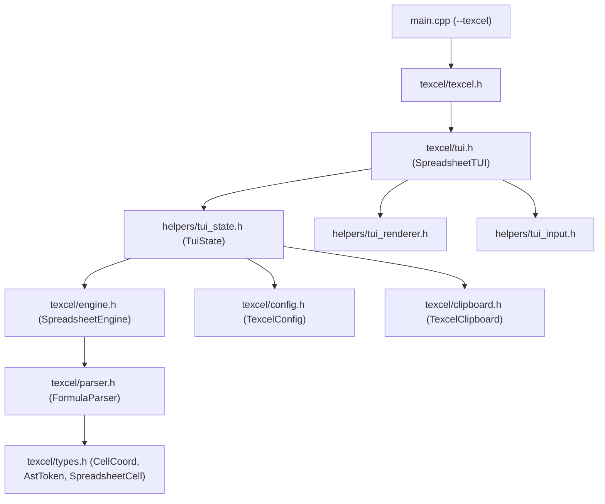

# Texcel — Hoja de Cálculo Reactiva en Consola (TUI)

**Texcel** es una hoja de cálculo interactiva para terminal (TUI) construida en C++23 sobre las estructuras de datos, iteradores, mixins y algoritmos de layout gráfico 2D desarrollados en este repositorio (`HashTable`, `BinaryTree`, `LinkedList`, `Vector`, `VerticalTreeLayout`, `HorizontalTreeLayout` y `ClippedGraphRenderer`).

---

## 1. Arquitectura del Subproyecto

El código fuente reside en [`texcel/`](file:///home/aldolunab/repos/2026-II-CS-UNI-CC0E5-AEDAv/texcel/) siguiendo una arquitectura acíclica por capas:



| Módulo | Responsabilidad |
| :--- | :--- |
| [`texcel/texcel.h`](file:///home/aldolunab/repos/2026-II-CS-UNI-CC0E5-AEDAv/texcel/texcel.h) | Punto de entrada único del subproyecto para `main.cpp` y tests. |
| [`texcel/types.h`](file:///home/aldolunab/repos/2026-II-CS-UNI-CC0E5-AEDAv/texcel/types.h) | Coordenadas `CellCoord` (`A1..ZZ999`), tokens AST (`AstToken`), estado de celda (`SpreadsheetCell`) y vista previa (`EvalPreview`). |
| [`texcel/parser.h`](file:///home/aldolunab/repos/2026-II-CS-UNI-CC0E5-AEDAv/texcel/parser.h) | Parser de descenso recursivo (`FormulaParser`) que compila fórmulas en un `BinaryTreeNode<AstToken>`. |
| [`texcel/engine.h`](file:///home/aldolunab/repos/2026-II-CS-UNI-CC0E5-AEDAv/texcel/engine.h) | Motor reactivo (`SpreadsheetEngine`): tabla dispersa, evaluación PostOrder, grafo de dependencias, propagación, detección de ciclos y Auto-Fill. |
| [`texcel/config.h`](file:///home/aldolunab/repos/2026-II-CS-UNI-CC0E5-AEDAv/texcel/config.h) | Gestión de `.config` (`autosave`, hoja activa) y listado de archivos `.txl` en `output/sheets/`. |
| [`texcel/clipboard.h`](file:///home/aldolunab/repos/2026-II-CS-UNI-CC0E5-AEDAv/texcel/clipboard.h) | Copia al portapapeles mediante secuencia ANSI OSC 52 y utilidades nativas (`wl-copy`, `xsel`, `xclip`). |
| [`texcel/tui.h`](file:///home/aldolunab/repos/2026-II-CS-UNI-CC0E5-AEDAv/texcel/tui.h) | Bucle principal interactivo (`termios` raw, `SIGWINCH`, coalescencia de arrastre SGR) y modo demo animado. |
| [`texcel/helpers/tui_state.h`](file:///home/aldolunab/repos/2026-II-CS-UNI-CC0E5-AEDAv/texcel/helpers/tui_state.h) | Estado de la UI, layout responsivo, scrollbars proporcionales, inserción de referencias en cursor y persistencia `.txl`. |
| [`texcel/helpers/tui_renderer.h`](file:///home/aldolunab/repos/2026-II-CS-UNI-CC0E5-AEDAv/texcel/helpers/tui_renderer.h) | Renderizado ANSI de los 4 paneles, barras de desplazamiento, modal de hojas y resaltado de selecciones. |
| [`texcel/helpers/tui_input.h`](file:///home/aldolunab/repos/2026-II-CS-UNI-CC0E5-AEDAv/texcel/helpers/tui_input.h) | Manejo de teclado, secuencias de escape, ratón SGR (clics, rangos, scrollbars, Auto-Fill) y modal. |

---

## 2. Motor Reactivo y Lenguaje de Fórmulas

### Almacenamiento y Grafo de Dependencias
- **Matriz dispersa (`702 × 999`)**: soporta columnas de `A` a `ZZ` (`CellCoord::MAX_COLS = 702`) y filas de `1` a `999` (`CellCoord::MAX_ROWS = 999`). Solo las celdas con contenido ocupan memoria en `HashTable`.
- **Evaluación en PostOrder**: cada fórmula se compila a un `BinaryTreeNode<AstToken>` y se evalúa en una sola pasada mediante `BinaryTreeIterator<AstToken, Order::PostOrder, Direction::Asc>`, generando además la traza RPN (`postorder_rpn`).
- **Propagación reactiva**: `m_inputs` y `m_dependents` (implementados como `HashTable` de `LinkedList`) rastrean qué celdas lee cada fórmula. Al modificar una celda, `SpreadsheetEngine` recalcula automáticamente todas sus dependientes.
- **Manejo de errores**: detecta y propaga `#CYCLE!` (referencias circulares), `#DIV/0!`, `#SYNTAX!` y `#REF!`.

### Expresiones, Operadores y Funciones Soportadas
- **Literales y texto**: números reales, cadenas entre comillas (`"Hola"`), booleanos (`TRUE` / `FALSE` como `"True"` / `"False"`) o texto explícito con prefijo `'` (ej. `'00123`). Toda celda sin `=` inicial ni valor numérico puro se preserva como texto literal (evitando que etiquetas como `"PC1"` o `"2026-09-03"` se evalúen como fórmulas).
- **Operadores**:
  - Aritméticos: `+`, `-`, `*`, `/`, `^` y unario `-`, con agrupación mediante `(...)`.
  - Concatenación de texto: `&` (ej. `= "Total: " & A1`).
  - Comparación: `=`, `<>`, `!=`, `<`, `<=`, `>`, `>=` (sobre números o texto).
- **Referencias**: relativas (`A1`), mixtas (`$A1`, `A$1`) y absolutas (`$A$1`), preservando los anclajes `$` al usar Auto-Fill.
- **Funciones de rango**:
  - `SUM(rango)`, `AVG(rango)`, `MIN(rango)`, `MAX(rango)`
- **Funciones escalares / variádicas y condicionales**:
  - `MIN(e1, e2, ...)` y `MAX(e1, e2, ...)` sobre expresiones arbitrarias (ej. `MIN(20, MAX(0, nota))`).
  - `IF(condición, valor_verdadero, valor_falso)` (representado en el AST binario mediante `FuncIf` + `IfBranches`).
  - `COUNTIF(rango, criterio)` y `COUNTIFS(r1, c1, r2, c2, ...)` — soporta criterios numéricos, referencias dinámicas (`E$4`), literales (`TRUE`), texto y comparadores (`>`, `>=`, `<`, `<=`, `=`, `<>`).

---

## 3. Interfaz Multi-Ventana (TUI)

La pantalla se divide dinámicamente según el tamaño de la terminal (`SIGWINCH`) en cuatro paneles coordinados:

1. **Matriz de Celdas (arriba izquierda)**:
   - **Name Box** en la esquina superior izquierda: muestra la celda activa y permite saltar a cualquier celda o rango (`A1:C5`).
   - **Mini-scrollbars proporcionales** (vertical y horizontal) integradas en los bordes del panel, manipulables directamente con el ratón.
   - **Esquina de Auto-Fill** en el borde inferior derecho de la celda activa para extender series numéricas o fórmulas relativas.
   - **Representación gráfica de booleanos**: las celdas con `"True"` / `"False"` se dibujan centradas como **`■`** (verde brillante) y **`□`** (gris tenue) manteniendo intacto su valor textual en el motor, Inspector y portapapeles.
2. **Navegador AST (arriba derecha)**:
   - Renderiza en tiempo real el árbol binario de la fórmula de la celda seleccionada (o de la fórmula en edición) usando `VerticalTreeLayout` / `HorizontalTreeLayout` y `ClippedGraphRenderer`, con sus propias barras de desplazamiento.
3. **Inspector de Dependencias (abajo derecha)**:
   - Muestra la fórmula original (`fx`), el valor evaluado, la secuencia PostOrder (RPN), las celdas de entrada y las celdas dependientes.
4. **Consola de Comandos y Logs (abajo izquierda)**:
   - Permite ingresar asignaciones directas (`A1 = 5`), valores (`42`) o fórmulas (`= SUM(A1:B3)`), mostrando **Live Preview** del resultado y del AST antes de confirmar con `Enter`.

---

## 4. Controles de Teclado y Ratón

### Modos de Enfoque
- **Modo 1 — Navegación en Matriz (`GridNavigation`)**:
  - `↑`/`↓`/`←`/`→`: mover el cursor por la hoja.
  - `Shift + Flechas`: seleccionar un rango de celdas.
  - Escribir directamente `=`, un dígito o texto inicia la edición en la consola y retorna automáticamente a la matriz al pulsar `Enter`.
  - `Supr` / `Backspace`: limpiar la celda activa o el rango seleccionado.
- **Modo 2 — Consola de Comandos (`CommandConsole`)**:
  - `Tab`: alternar entre Matriz y Consola (al entrar manualmente precarga el contenido actual de la celda).
  - `←`/`→`, `Home`/`End`, `Ctrl+U`: mover el cursor dentro del buffer o limpiarlo.
  - **Inserción de referencias al editar fórmulas**: mientras el buffer es una fórmula (`=...`), hacer clic o arrastrar sobre la matriz inserta la celda o rango (`A1`, `A1:C3`) exactamente en la posición del cursor de la consola sin perder el foco de edición.
  - **Confirmación automática al cambiar de celda**: si se edita un valor no fórmula en Modo 2 y se hace clic sobre otra celda de la matriz, el valor pendiente se guarda primero en la celda activa anterior antes de mover el cursor.
  - `Tab` durante la edición de una fórmula activa/alterna **Point Mode** para seleccionar celdas con el teclado.

### Atajos Globales y Ratón (SGR Mouse Tracking)
| Atajo / Acción | Función |
| :--- | :--- |
| `Ctrl+G` o clic en **Name Box** | Ir a celda o rango (doble clic en Name Box salta a `A1`). |
| `Ctrl+S` | Guardar la hoja actual en `output/sheets/<nombre>.txl`. |
| `Ctrl+O` | Abrir el gestor modal de hojas (abrir, crear o eliminar hojas `.txl`). |
| `Ctrl+C`, `Y` o Clic Derecho | Copiar la selección de celdas o texto sombreado al portapapeles. |
| `Ctrl+Clic` o arrastrar esquina activa | **Auto-Fill** interactivo de series o fórmulas. |
| Clic/arrastre en bordes del panel | Desplazamiento proporcional mediante las mini-scrollbars de Matriz o AST. |
| `q` (en Matriz) / `Ctrl+D` | Salir de Texcel restaurando la terminal. |

---

## 5. Persistencia de Hojas y Configuración

Las hojas se almacenan en `output/sheets/` con extensión `.txl` utilizando los operadores de flujo (`Printable` / `Readable`) de `HashTable` sobre `m_raw_table` (`celda -> expresión cruda`), lo que reconstruye automáticamente el grafo de dependencias y los valores al volver a abrir la hoja.

El archivo `output/sheets/.config` guarda:
- `autosave=1|0`: si está activo, carga automáticamente la última hoja al iniciar.
- `current=<nombre>`: hoja activa por defecto.

---

## 6. Compilación, Ejecución y Pruebas

Desde la raíz del repositorio:

```bash
# Compilar y ejecutar Texcel en modo interactivo
make texcel

# Ejecutar toda la suite (pruebas unitarias + pruebas E2E con PTY)
make test

# Ejecutar solo pruebas unitarias o solo E2E
make test-unit
make test-e2e
```

La suite de pruebas en [`texcel/tests/`](file:///home/aldolunab/repos/2026-II-CS-UNI-CC0E5-AEDAv/texcel/tests/) cubre:
- **Unitarias (`texcel/tests/unit/`)**:
  - `test_eval_prepost.cpp`: evaluación PostOrder, precedencia, unarios, concatenación `&` y funciones.
  - `test_deps_persistence.cpp`: propagación reactiva, ciclos `#CYCLE!` y persistencia `.txl`.
  - `test_ranges_autofill.cpp`: rangos, `COUNTIF`/`COUNTIFS` y Auto-Fill con referencias `$`.
  - `test_tui_navigation.cpp`: Name Box, scrollbars, inserción de referencias en cursor, confirmación al hacer clic y modos de enfoque.
  - `test_tui_text.cpp`: utilidades de texto y truncado ANSI.
- **End-to-End (`texcel/tests/e2e/test_tui_pty.py`)**: pruebas automatizadas sobre pseudoterminal (PTY) real verificando el flujo interactivo completo.
