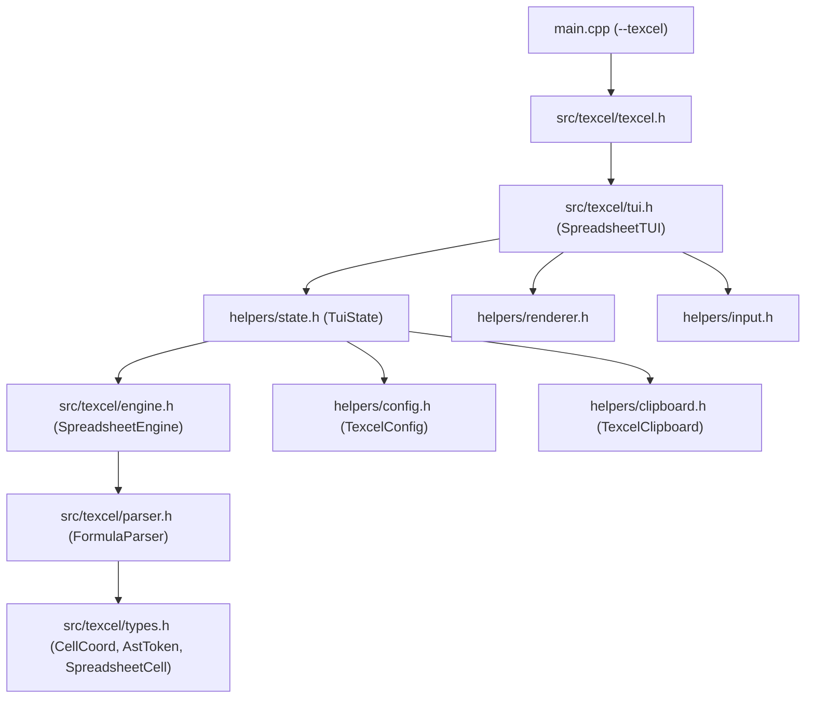

# Texcel — Hoja de Cálculo Reactiva en Consola (TUI)

**Texcel** es una hoja de cálculo interactiva para terminal (TUI) construida en C++23 sobre las estructuras de datos, iteradores, mixins y algoritmos de layout gráfico 2D desarrollados en este repositorio (`HashTable`, `BinaryTree`, `LinkedList`, `Vector`, `VerticalTreeLayout`, `HorizontalTreeLayout` y `ClippedGraphRenderer`).

---

## 1. Arquitectura del Subproyecto

El código fuente reside en [`src/texcel/`](../src/texcel/) siguiendo una arquitectura acíclica por capas:



| Módulo | Responsabilidad |
| :--- | :--- |
| [`src/texcel/texcel.h`](../src/texcel/texcel.h) | Punto de entrada único del subproyecto para `main.cpp` y tests. |
| [`src/texcel/types.h`](../src/texcel/types.h) | Coordenadas `CellCoord` (`A1..ZZ999`), tokens AST (`AstToken`), estado de celda (`SpreadsheetCell`) y vista previa (`EvalPreview`). |
| [`src/texcel/parser.h`](../src/texcel/parser.h) | Parser por Precedence Climbing (`FormulaParser`) con RAII (`AstPtr`) que compila fórmulas en un `BinaryTreeNode<AstToken>`. |
| [`src/texcel/engine.h`](../src/texcel/engine.h) | Motor reactivo (`SpreadsheetEngine`): tabla dispersa, evaluación PostOrder, grafo de dependencias, propagación, detección de ciclos y Auto-Fill. |
| [`src/texcel/tui.h`](../src/texcel/tui.h) | Bucle principal interactivo (`termios` raw, `SIGWINCH`, coalescencia de arrastre SGR). |
| [`src/texcel/helpers/config.h`](../src/texcel/helpers/config.h) | Gestión de `.config` (`autosave`, hoja activa) y listado de archivos `.txl` en `output/sheets/`. |
| [`src/texcel/helpers/clipboard.h`](../src/texcel/helpers/clipboard.h) | Copia al portapapeles mediante secuencia ANSI OSC 52 y utilidades nativas (`wl-copy`, `xsel`, `xclip`). |
| [`src/texcel/helpers/text.h`](../src/texcel/helpers/text.h) | Utilidades de formato de celdas/rangos y secuencias de control de sesión TUI. |
| [`src/texcel/helpers/state.h`](../src/texcel/helpers/state.h) | Estado de la UI, layout responsivo, scrollbars proporcionales, inserción de referencias en cursor y persistencia `.txl`. |
| [`src/texcel/helpers/renderer.h`](../src/texcel/helpers/renderer.h) | Renderizado ANSI de los 4 paneles, proyección visual del AST, barras de desplazamiento, modal de hojas y resaltado de selecciones. |
| [`src/texcel/helpers/input.h`](../src/texcel/helpers/input.h) | Manejo de teclado, secuencias de escape, ratón SGR (clics, rangos, scrollbars, Auto-Fill) y modal. |

---

## 2. Motor Reactivo y Lenguaje de Fórmulas

### Almacenamiento y Grafo de Dependencias
- **Matriz dispersa (`702 × 999`)**: soporta columnas de `A` a `ZZ` (`CellCoord::MAX_COLS = 702`) y filas de `1` a `999` (`CellCoord::MAX_ROWS = 999`). Solo las celdas con contenido ocupan memoria en `HashTable`.
- **Evaluación en PostOrder**: cada fórmula se compila a un `BinaryTreeNode<AstToken>` y se evalúa en una sola pasada mediante `BinaryTreeIterator<AstToken, Order::PostOrder, Direction::Asc>`, generando además la traza RPN (`postorder_rpn`).
- **Propagación reactiva y caché `dirty`**: cada `SpreadsheetCell` en `m_cells` almacena su lista `inputs` y una bandera `dirty`, mientras `m_dependents` (`HashTable` de `LinkedList`) rastrea sus observadores. Al modificar una celda, `SpreadsheetEngine` marca `dirty` el subgrafo alcanzable y recalcula únicamente las celdas afectadas, leyendo desde `m_cells` las celdas limpias.
- **Manejo de errores**: detecta y propaga `#CYCLE!` (referencias circulares), `#DIV/0!`, `#SYNTAX!` y `#REF!`.

### Expresiones, Operadores y Funciones Soportadas
- **Literales y texto**: números reales, cadenas entre comillas (`"Hola"`), booleanos (`TRUE` / `FALSE` como `"True"` / `"False"`) o texto explícito con prefijo `'` (ej. `'00123`). Toda celda sin `=` inicial ni valor numérico puro se preserva como texto literal (evitando que etiquetas como `"PC1"` o `"2026-09-03"` se evalúen como fórmulas).
- **Operadores**:
  - Aritméticos: `+`, `-`, `*`, `/`, `^` y unario `-`, con agrupación mediante `(...)`.
  - Concatenación de texto: `&` (ej. `= "Total: " & A1`).
  - Comparación: `=`, `<>`, `!=`, `<`, `<=`, `>`, `>=` (sobre números o texto).
- **Referencias**: relativas (`A1`), mixtas (`$A1`, `A$1`) y absolutas (`$A$1`), preservando los anclajes `$` al usar Auto-Fill.
- **Funciones de rango, escalares y variádicas**:
  - `SUM(...)`, `AVG(...)`, `MIN(...)`, `MAX(...)` y `CONCAT(...)`: aceptan rangos (`A1:B2`), expresiones escalares o combinaciones de ambos (ej. `MIN(20, MAX(0, nota))`, `SUM(A1:A3, 10)`).
- **Funciones condicionales**:
  - `IF(condición, valor_verdadero, valor_falso)` (representado en el AST binario mediante `FuncCall` + espina `ArgPair`).
  - `COUNTIF(rango, criterio)` y `COUNTIFS(r1, c1, r2, c2, ...)` — soporta criterios numéricos, referencias dinámicas (`E$4`), literales (`TRUE`), texto y comparadores (`>`, `>=`, `<`, `<=`, `=`, `<>`).

---

## 3. Interfaz Multi-Ventana (TUI)

La pantalla se divide dinámicamente según el tamaño de la terminal (`SIGWINCH`) en cuatro paneles coordinados:

1. **Matriz de Celdas (arriba izquierda)**:
   - **Name Box** en la esquina superior izquierda: muestra la celda activa y permite saltar a cualquier celda o rango (`A1:C5`).
   - **Mini-scrollbars proporcionales** (vertical y horizontal) integradas en los bordes del panel, manipulables directamente con el ratón.
   - **Esquina de Auto-Fill** en el borde inferior derecho de la celda activa para extender series numéricas o fórmulas relativas.
   - **Representación gráfica de booleanos**: las celdas con `"True"` / `"False"` se dibujan centradas como **`■`** (verde brillante) y **`□`** (gris tenue) manteniendo intacto su valor textual en el motor, Inspector y portapapeles.
2. **Navegador AST (arriba derecha)**:
   - Renderiza en tiempo real el árbol binario de la fórmula de la celda seleccionada (o de la fórmula en edición) usando `VerticalTreeLayout` / `HorizontalTreeLayout` y `ClippedGraphRenderer`, con sus propias barras de desplazamiento.
3. **Inspector de Dependencias (abajo derecha)**:
   - Muestra la fórmula original (`fx`), el valor evaluado, la secuencia PostOrder (RPN), las celdas de entrada y las celdas dependientes.
4. **Consola de Comandos y Logs (abajo izquierda)**:
   - Permite ingresar asignaciones directas (`A1 = 5`), valores (`42`) o fórmulas (`= SUM(A1:B3)`), mostrando **Live Preview** del resultado y del AST antes de confirmar con `Enter`.

---

## 4. Controles de Teclado y Ratón

### Modos de Enfoque
- **Modo 1 — Navegación en Matriz (`GridNavigation`)**:
  - `↑`/`↓`/`←`/`→`: mover el cursor por la hoja.
  - `Shift + Flechas`: seleccionar un rango de celdas.
  - Escribir directamente `=`, un dígito o texto inicia la edición en la consola y retorna automáticamente a la matriz al pulsar `Enter`.
  - `Supr` / `Backspace`: limpiar la celda activa o el rango seleccionado.
- **Modo 2 — Consola de Comandos (`CommandConsole`)**:
  - `Tab`: alternar entre Matriz y Consola (al entrar manualmente precarga el contenido actual de la celda).
  - `←`/`→`, `Home`/`End`, `Ctrl+U`: mover el cursor dentro del buffer o limpiarlo.
  - **Inserción de referencias al editar fórmulas**: mientras el buffer es una fórmula (`=...`), hacer clic o arrastrar sobre la matriz inserta la celda o rango (`A1`, `A1:C3`) exactamente en la posición del cursor de la consola sin perder el foco de edición.
  - **Confirmación automática al cambiar de celda**: si se edita un valor no fórmula en Modo 2 y se hace clic sobre otra celda de la matriz, el valor pendiente se guarda primero en la celda activa anterior antes de mover el cursor.
  - `Tab` durante la edición de una fórmula activa/alterna **Point Mode** para seleccionar celdas con el teclado.

### Atajos Globales y Ratón (SGR Mouse Tracking)
| Atajo / Acción | Función |
| :--- | :--- |
| `Ctrl+G` o clic en **Name Box** | Ir a celda o rango (doble clic en Name Box salta a `A1`). |
| `Ctrl+S` | Guardar la hoja actual en `output/sheets/<nombre>.txl`. |
| `Ctrl+O` | Abrir el gestor modal de hojas (abrir, crear o eliminar hojas `.txl`). |
| `Ctrl+C`, `Y` o Clic Derecho | Copiar la selección de celdas o texto sombreado al portapapeles. |
| `Ctrl+Clic` o arrastrar esquina activa | **Auto-Fill** interactivo de series o fórmulas. |
| Clic/arrastre en bordes del panel | Desplazamiento proporcional mediante las mini-scrollbars de Matriz o AST. |
| `q` (en Matriz) / `Ctrl+D` | Salir de Texcel restaurando la terminal. |

---

## 5. Persistencia de Hojas y Configuración

Las hojas se almacenan en `output/sheets/` con extensión `.txl` utilizando los operadores de flujo (`Printable` / `Readable`) de `HashTable` sobre `m_raw_table` (`celda -> expresión cruda`), lo que reconstruye automáticamente el grafo de dependencias y los valores al volver a abrir la hoja.

El archivo `output/sheets/.config` guarda:
- `autosave=1|0`: si está activo, carga automáticamente la última hoja al iniciar.
- `current=<nombre>`: hoja activa por defecto.

---

## 6. Compilación, Ejecución y Pruebas

Desde la raíz del repositorio:

```bash
# Compilar y ejecutar Texcel en modo interactivo
make texcel

# Ejecutar toda la suite (pruebas unitarias + pruebas E2E con PTY)
make test

# Ejecutar solo pruebas unitarias, E2E o de rendimiento
make test-unit
make test-e2e
make test-perf
```

La suite de pruebas en [`tests/texcel/`](../tests/texcel/) cubre:
- **Unitarias (`tests/texcel/unit/`)**:
  - `test_eval_prepost.cpp`: evaluación PostOrder, precedencia, unarios, concatenación `&` y funciones.
  - `test_deps_persistence.cpp`: propagación reactiva, ciclos `#CYCLE!` y persistencia `.txl`.
  - `test_ranges_autofill.cpp`: rangos, `COUNTIF`/`COUNTIFS` y Auto-Fill con referencias `$`.
  - `test_tui_navigation.cpp`: Name Box, scrollbars, inserción de referencias en cursor, confirmación al hacer clic y modos de enfoque.
  - `test_tui_text.cpp`: utilidades de texto y truncado ANSI.
- **End-to-End (`tests/texcel/e2e/test_tui_pty.py`)**: pruebas automatizadas sobre pseudoterminal (PTY) real verificando el flujo interactivo completo.
- **Rendimiento (`tests/texcel/performance/`)**: benchmarks estandarizados (`gen_perf_sheets.py` + `bench_texcel.cpp`) sobre hojas de ~20,000 celdas (simple encadenada y mixta), cuyo registro histórico de hitos se documenta en [`texcel_performance.md`](texcel_performance.md).

---

## 7. Detalles Clave de Implementación y Mecánicas TUI

Esta sección resume los mecanismos internos que hacen que el motor y la interfaz en consola se sientan fluidos y predecibles.

### 1. Cómo existen múltiples ventanas independientes en una terminal
Texcel no usa `ncurses` ni librerías externas de ventanas; construye su propio sistema de ventanas directamente sobre secuencias ANSI:
- **Pantalla alternativa y coordenadas absolutas (`gotoxy`):** [`SpreadsheetTUI::runInteractive`](../src/texcel/tui.h) activa el buffer alternativo de la terminal (`\033[?1049h`) y desactiva el salto automático de línea (`\033[?7l`). A partir de ahí, [`renderAll`](../src/texcel/helpers/renderer.h) dibuja cada panel (`renderGridWindow`, `renderInspectorWindow`, `renderCommandWindow`, `renderActivityWindow` y los modales) saltando directamente a sus coordenadas `(x, y)` con `gotoxy(st.ros(), x, y)` y recortando cada fila a su ancho interno exacto con `fitWidth` para que ningún texto desborde hacia la ventana vecina.
- **Partición geométrica responsiva (`SIGWINCH`):** [`TuiState::updateLayout`](../src/texcel/helpers/state.h) consulta `ioctl(STDOUT_FILENO, TIOCGWINSZ, &ws)` y divide el ancho total en un ~38% para la columna derecha (`right_w`, acotado a `[26, 68]`) y el resto para la matriz izquierda (`left_w`), recalculando cuántas columnas de celdas caben (`visible_cols`). Cuando el usuario cambia el tamaño de la terminal, la señal `SIGWINCH` activa el recálculo y redibuja todo.
- **Recorte 2D del AST dentro de su ventana:** dentro de `renderInspectorWindow`, [`ClippedGraphRenderer`](../src/texcel/helpers/renderer.h) actúa como un *viewport* que recorta la proyección del árbol (`VerticalTreeLayout` / `HorizontalTreeLayout`) al rectángulo visible de la Ventana 2 según `(ast_scroll_x, ast_scroll_y)`.
- **Enrutamiento de ratón por panel:** cada evento SGR `(mx, my)` determina en qué rectángulo cayó (`drag_win`), manteniendo la selección de celdas (ventana 1) aislada de la selección de texto (ventanas 2–4).

### 2. Parser por Precedence Climbing y evaluación del AST con `Order::PrePostOrder`
- **Parser compacto y RAII ([`src/texcel/parser.h`](../src/texcel/parser.h)):** en lugar de una cascada de funciones por nivel de precedencia, [`parseBinary`](../src/texcel/parser.h) usa *Precedence Climbing* sobre la tabla centralizada [`BINARY_OPS`](../src/texcel/types.h) y punteros inteligentes `AstPtr` (`std::unique_ptr` con `freeAst`) para evitar fugas ante errores de sintaxis. `parsePrimary` reconoce `CellRef` (`A1`) y `CellRange` (`A1:B2`) en un único punto, y todas las funciones (`SUM`, `AVG`, `MIN`, `MAX`, `CONCAT`, `IF`, `COUNTIF`, `COUNTIFS`) se parsean uniformemente con [`parseFunctionCall`](../src/texcel/parser.h) formando un nodo `FuncCall` con una espina binaria de `ArgPair` (`,`).
- **Evaluación in-place sin pila externa ([`evaluateAstPostOrder`](../src/texcel/engine.h)):** recorre `BinaryTreeNode<AstToken>` mediante `BinaryTreeIterator<AstToken, Order::PrePostOrder, Direction::Asc>`, visitando cada nodo dos veces:
  - **Bajada (`Phase::Pre`):** el operador padre propaga hacia sus hijos el tipo esperado (`expected_type`: `Number` para aritmética, `Text` para `&` o `Any` para comparaciones y funciones).
  - **Subida (`Phase::Post`):** los hijos dejan su resultado en `AstToken::evaluated`; el padre valida tipos (`#VALUE!`), evalúa su resultado in-place (incluidos los criterios de `COUNTIF`/`COUNTIFS`, sin re-parsear texto en tiempo de evaluación) y emite la traza RPN (`postorder_rpn`).

### 3. Regla estricta de texto literal vs. fórmula
En hojas con encabezados reales como `"PC1"`, `"PC2"` o fechas como `"2026-09-03"`, un parser permisivo interpretaría `"PC1"` como una referencia a la columna `PC`, fila `1`, o `"2026-09-03"` como una resta (`2014`). Por ello [`evaluateRawExpression`](../src/texcel/engine.h) y [`resolveCellValue`](../src/texcel/engine.h) solo invocan `FormulaParser` cuando la celda comienza con `=` (o es un número puro); cualquier otro contenido se preserva como texto literal.

### 4. Coalescencia de ráfagas SGR Mouse Drag (arrastre sin lag)
Al arrastrar el ratón sobre la matriz o sobre una barra de desplazamiento, la terminal envía decenas de secuencias `\033[<...M` por segundo. Si se redibujara toda la pantalla en cada evento, el renderizado quedaría rezagado detrás del puntero. En [`SpreadsheetTUI::runInteractive`](../src/texcel/tui.h), tras procesar una secuencia `\033` durante un arrastre (`m_st.isAnyDragging()`), un bucle con `poll(..., 0)` drena todos los eventos de ratón ya encolados en `stdin` y solo llama a `renderAll()` una vez al vaciar la ráfaga.

### 5. Mini-scrollbars proporcionales en los bordes del panel
Las barras de desplazamiento viven directamente sobre el marco del panel para no sacrificar celdas visibles ([`drawVerticalScrollbar`](../src/texcel/helpers/renderer.h)):
- La barra vertical usa un pulgar de 2 filas (`█`) y la horizontal un pulgar de hasta 9 columnas (`▬`), haciéndolas fáciles de agarrar con el ratón.
- [`scrollVerticalToScreenY`](../src/texcel/helpers/state.h) y [`scrollHorizontalToScreenX`](../src/texcel/helpers/state.h) mapean la coordenada del puntero vía `mapScrollTrack` y mantienen activo el arrastre incluso si el cursor se desvía vertical u horizontalmente fuera del borde mientras el botón sigue presionado.

### 6. Inserción de referencias en el cursor y confirmación al cambiar de celda
En Modo 2 (`CommandConsole`), [`insertOrReplaceRefAtCursor`](../src/texcel/helpers/state.h) guarda el ancla (`console_ref_pos`, `console_ref_len`) de la referencia insertada al hacer clic o arrastrar en la matriz mientras se edita una fórmula (`=...`). Así, arrastrar para seleccionar `A1:C3` actualiza en vivo ese fragmento exacto dentro del buffer sin mover el resto de la fórmula. Si en cambio se está editando un valor no fórmula y se hace clic en otra celda, [`handleSgrMouse`](../src/texcel/helpers/input.h) confirma primero el valor pendiente en la celda anterior antes de cambiar el foco.

### 7. Renderizado sin parpadeo, selección confinada y portapapeles
- **Buffer de frame único:** `TuiState::ros()` acumula todas las secuencias ANSI del frame en memoria y las envía a `std::ostream` en un solo `flush` envuelto en sincronización de terminal (`\033[?2026h ... \033[?2026l`), evitando parpadeos al redimensionar (`SIGWINCH`) o arrastrar.
- **Copia limpia entre ventanas:** al sombrear texto con el ratón en el Navegador AST, Inspector o Consola, [`stripDividerGlyphs`](../src/texcel/helpers/text.h) elimina los caracteres de borde (`│`, `─`, `╭`, etc.) antes de enviar el texto a [`TexcelClipboard::copy`](../src/texcel/helpers/clipboard.h) (vía OSC 52 y `wl-copy`/`xsel`/`xclip`).
